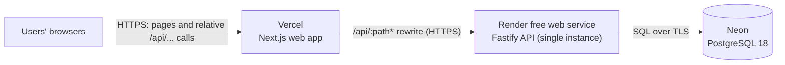

<div align="center">

# DiffCraft

**Collaborative Code Review and AI-Assisted Debugging Platform**

[](https://github.com/man-singh-dev/diffCraft/actions/workflows/ci.yml)


**Live demo:** [diffcraft-three.vercel.app](https://diffcraft-three.vercel.app)

<sub>The API runs on a free instance that sleeps after inactivity, so the first request can take about a minute.</sub>

</div>

> [!IMPORTANT]
> **DiffCraft is in its initial development stage.** These docs describe the product vision and the _intended_ architecture. Unless a section is explicitly labeled **Implemented**, the features, schema, endpoints, commands and deployment described here are **Planned** and do not yet exist in the codebase. The status table in [docs/roadmap.md](docs/roadmap.md#current-status) is the source of truth and is updated as work lands.

---

## What it is

DiffCraft is a collaborative code review platform: line-anchored comments and threads on a diff, recorded review decisions (approve / request changes), and AI-assisted findings that reviewers verify like any other comment.
It is also built as a deliberate backend-engineering project: relational data modeling, authorization, reliable real-time updates, background jobs and safe integration of an LLM provider.
More in [docs/architecture.md](docs/architecture.md).

---

## Screenshots

> [!NOTE]
> So far the UI has only the home, sign-up, login and profile pages (try them in the [live demo](https://diffcraft-three.vercel.app)). The review screens below don't exist yet; their placeholders will be replaced with real screenshots once they are implemented.

| Screen                                                             | Status  |
| ------------------------------------------------------------------ | ------- |
| _Placeholder:_ Review list with status filters                     | Planned |
| _Placeholder:_ Side-by-side diff with inline comment thread        | Planned |
| _Placeholder:_ AI findings panel with severity and line references | Planned |
| _Placeholder:_ Review approval / change-request panel              | Planned |

<!-- Example once available:

-->

---

## Features

**Implemented**

- Email/password sign-up, login, logout and a profile page.
- Server-side sessions in HttpOnly cookies, with Argon2id password hashing and a CSRF Origin check ([security](docs/security.md)).
- PostgreSQL schema and migrations for users and sessions ([database](docs/database.md)).
- `GET /health` and `GET /ready` probes, and a home page showing API health.
- CI on every PR, and a live deployment on Vercel, Render and Neon ([deployment](docs/deployment.md)).

**Planned**

- Workspaces with roles and invitations.
- Reviews from patch uploads, with unified and side-by-side diff views.
- Line-anchored comments, threads, resolution, and approve / request-changes decisions.
- Real-time updates and presence over Socket.IO ([design](docs/design/realtime.md)).
- AI analysis in a background worker, producing structured, line-referenced findings ([design](docs/design/ai-analysis.md)).

---

## Tech stack

| Layer                | In use now                                                   | Planned                       |
| -------------------- | ------------------------------------------------------------ | ----------------------------- |
| Frontend             | Next.js, TypeScript, Tailwind CSS                            |                               |
| API                  | Node.js, Fastify (`@fastify/cookie`), Zod, Argon2id          | Socket.IO, OpenAPI generation |
| Data                 | PostgreSQL 18, Drizzle ORM                                   | Redis                         |
| Background jobs / AI |                                                              | BullMQ, an LLM provider       |
| Tooling              | pnpm workspaces, Vitest, ESLint, Prettier, esbuild           |                               |
| Infra                | Docker Compose (local), GitHub Actions, Vercel, Render, Neon | Dockerfiles                   |

Rationale for each choice: [docs/architecture.md](docs/architecture.md#technology-stack).

---

## Architecture

The current deployment:



A background worker for AI analysis and Redis (for BullMQ queues and the Socket.IO adapter) are planned for Stages 7–8; see the [future architecture](docs/architecture.md#future-architecture-planned).

---

## Quick start

Requires Node.js 24, pnpm 12 and Docker. Full details, checks and environment variables are in [docs/development.md](docs/development.md).

```bash
git clone https://github.com/man-singh-dev/diffCraft.git
cd diffCraft
cp .env.example .env                 # PowerShell: Copy-Item .env.example .env
pnpm install
pnpm infra:up                        # local PostgreSQL and Redis
pnpm db:migrate
pnpm dev                             # web http://localhost:3000, API http://localhost:4000
```

---

## Documentation

| File                                                     | What it covers                                                                        |
| -------------------------------------------------------- | ------------------------------------------------------------------------------------- |
| [docs/README.md](docs/README.md)                         | Index of the docs folder.                                                             |
| [docs/architecture.md](docs/architecture.md)             | Goals, features, components, data flow, review lifecycle, deployment architecture.    |
| [docs/database.md](docs/database.md)                     | Implemented and proposed tables, constraints, indexes, transactions, pagination.      |
| [docs/api.md](docs/api.md)                               | API conventions and every implemented and proposed endpoint.                          |
| [docs/security.md](docs/security.md)                     | How authentication works, the planned authorization model, security safeguards.       |
| [docs/development.md](docs/development.md)               | Local setup, environment variables, Docker, project structure, testing, contributing. |
| [docs/deployment.md](docs/deployment.md)                 | Vercel, Render and Neon setup, and the variables each host needs.                     |
| [docs/design/realtime.md](docs/design/realtime.md)       | Planned Socket.IO rooms, events and broadcast rules.                                  |
| [docs/design/ai-analysis.md](docs/design/ai-analysis.md) | Planned AI analysis pipeline, background jobs and failure handling.                   |
| [docs/roadmap.md](docs/roadmap.md)                       | Detailed current status, the full roadmap and future enhancements.                    |

---

## Roadmap

| Stage                         | Status          |
| ----------------------------- | --------------- |
| 0. Foundation                 | **Implemented** |
| 1. Database and auth          | **Implemented** |
| 2. Workspaces and roles       | Planned         |
| 3. Reviews and diff ingestion | Planned         |
| 4. Diff viewer                | Planned         |
| 5. Comments and threads       | Planned         |
| 6. Approvals and lifecycle    | Planned         |
| 7. Real-time                  | Planned         |
| 8. AI analysis                | Planned         |
| 9. Hardening and deployment   | Planned         |

Scope of each stage: [docs/roadmap.md](docs/roadmap.md#development-roadmap).

---

## Known Limitations

- **Cold starts.** The API runs on a free Render instance that sleeps after inactivity, so the first request after a quiet period can take about a minute.
- **No rate limiting yet.** Login and registration are not rate-limited. Rate limiting is planned (Stage 9).
- **Email enumeration on register.** `POST /api/v1/auth/register` returns `409` when the email is already registered, which reveals whether an account exists. This stays until email verification is added.
- **No custom domain yet.** The app is served from its default Vercel URL.

---

## Contributing

Contributions and design feedback are welcome. Open an issue first for anything non-trivial, keep each pull request to one concern, and never commit secrets.
The full guidelines are in [docs/development.md](docs/development.md#contributing).

---

## License

**License status: undecided.** No license file has been added yet. Until a license is chosen and a `LICENSE` file is committed, all rights are reserved by the author by default, and the code may not be reused without permission.
