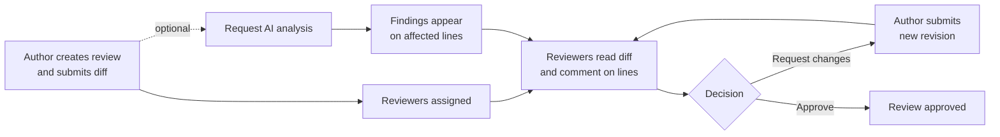
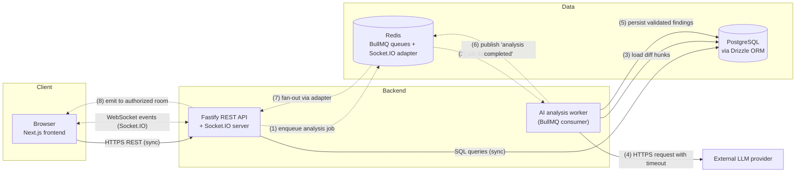
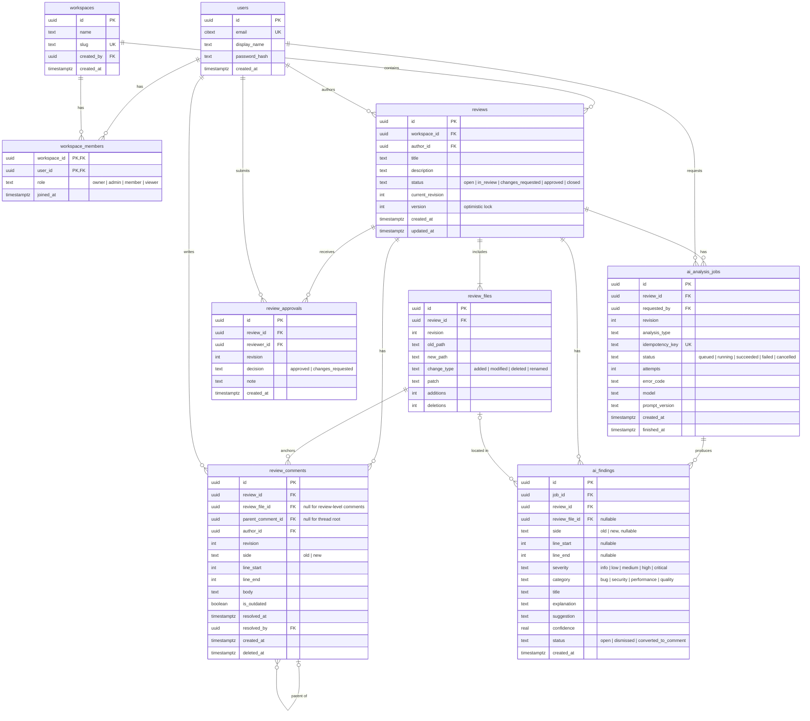
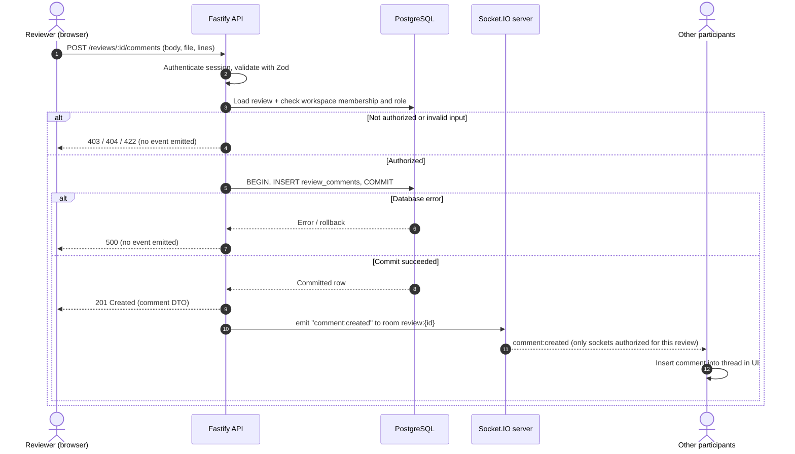
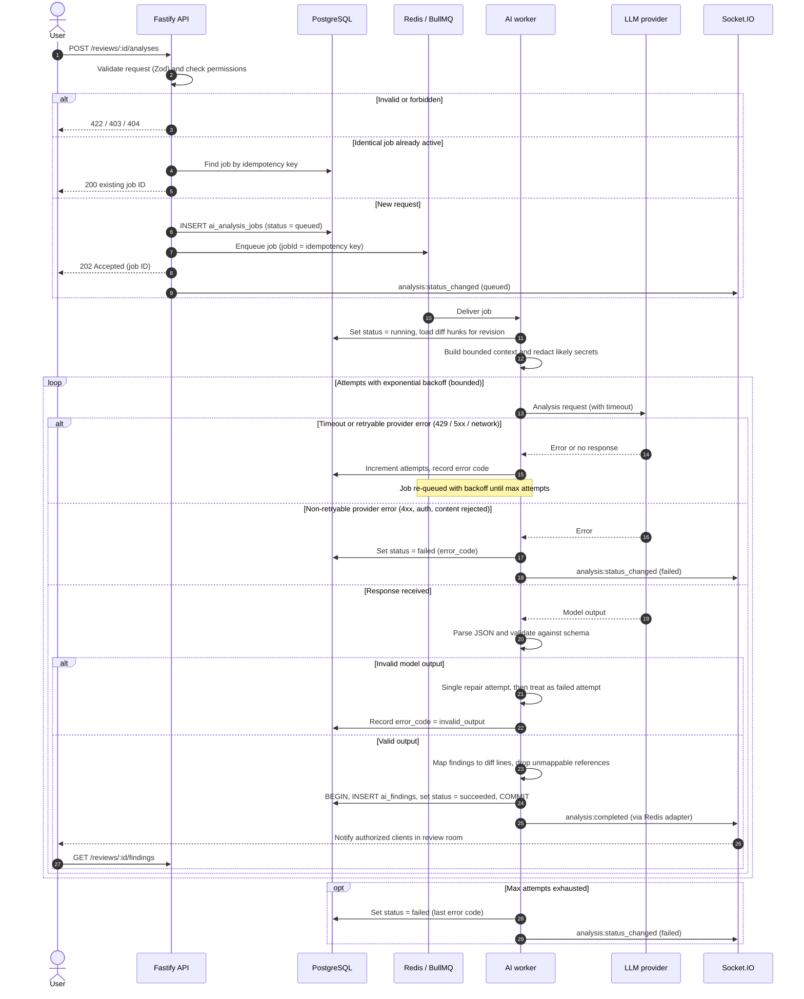
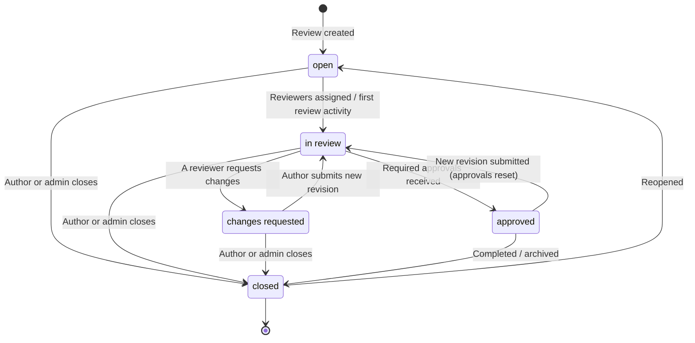
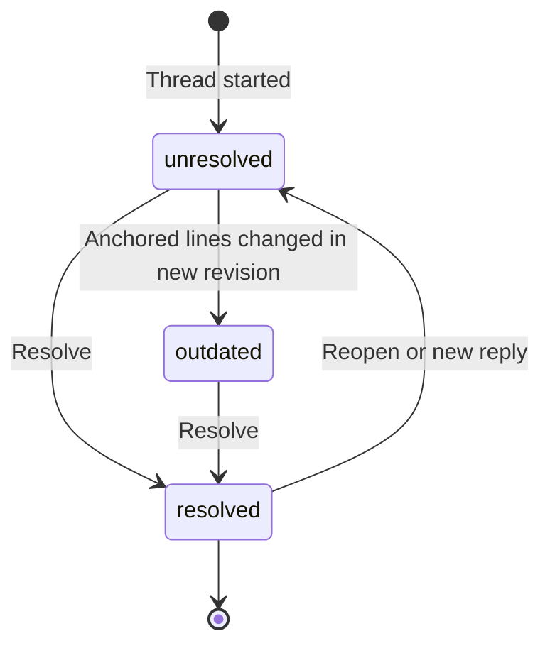
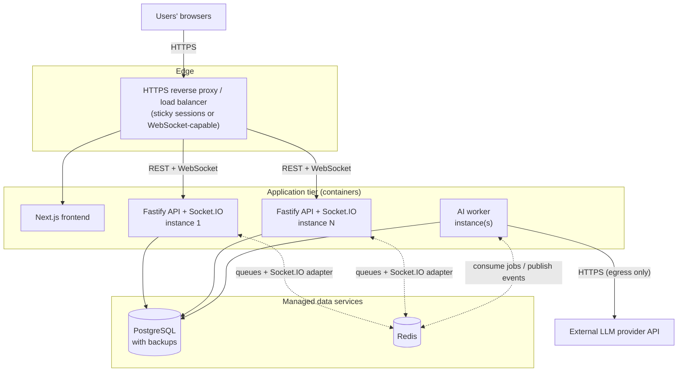

<div align="center">

# DiffCraft

**Collaborative Code Review and AI-Assisted Debugging Platform**


</div>

> [!IMPORTANT]
> **DiffCraft is in its initial development stage.** This README describes the product vision and the *intended* architecture. Unless a section is explicitly labeled **Implemented**, the features, schema, endpoints, commands and deployment described here are **Planned** and do not yet exist in the codebase. The status table below is the source of truth and will be updated as work lands.

---

## Table of Contents

- [Current Status](#current-status)
- [Overview](#overview)
- [Problem Statement](#problem-statement)
- [Goals and Design Principles](#goals-and-design-principles)
- [Key Features](#key-features)
- [Product Workflow](#product-workflow)
- [Screenshots](#screenshots)
- [High-Level Architecture](#high-level-architecture)
- [Component Responsibilities](#component-responsibilities)
- [Technology Stack](#technology-stack)
- [Data Flow](#data-flow)
- [Database Design](#database-design)
- [API Design](#api-design)
- [Authentication and Authorization](#authentication-and-authorization)
- [Real-Time Event Architecture](#real-time-event-architecture)
- [AI Analysis Pipeline](#ai-analysis-pipeline)
- [Background Jobs and Failure Handling](#background-jobs-and-failure-handling)
- [Security Considerations](#security-considerations)
- [Testing Strategy](#testing-strategy)
- [Local Development Setup](#local-development-setup)
- [Environment Variables](#environment-variables)
- [Docker Setup](#docker-setup)
- [Project Structure](#project-structure)
- [Deployment Architecture](#deployment-architecture)
- [Development Roadmap](#development-roadmap)
- [Future Enhancements](#future-enhancements)
- [Contributing](#contributing)
- [License](#license)

---

## Current Status

| Area | Status | Notes |
| --- | --- | --- |
| Repository and documentation | **In progress** | This README defines scope and intended architecture. |
| Monorepo scaffolding (`apps/web`, `apps/api`, `packages/shared`) | Planned | Package manager and workspace tooling not yet committed. |
| Database schema and migrations (Drizzle) | Planned | Schema below is a proposal, not final. |
| Authentication and workspace membership | Planned | |
| Code diff viewer | Planned | |
| Reviews, comments, threads, approvals | Planned | |
| Real-time collaboration (Socket.IO) | Planned | |
| AI analysis worker (BullMQ + LLM provider) | Planned | |
| Tests (Vitest) | Planned | No tests exist yet; no coverage figures are claimed. |
| Docker / CI | Planned | No Dockerfile, Compose file or CI workflow exists yet. |
| OpenAPI documentation | Planned | To be generated from Zod route schemas. |

Status labels used throughout: **Implemented** · **In progress** · **Planned**.

---

## Overview

DiffCraft is a collaborative code review platform. It is designed to help developers understand code changes, discuss potential bugs in the context of specific lines, record review decisions, and request AI-assisted analysis of the changed code — all within a single workspace.

The goal is to bring four things that are usually scattered across tools into one place:

1. **The diff** — what changed, file by file and line by line.
2. **The discussion** — threaded, line-anchored conversations about those changes.
3. **The decision** — reviewer assignments, approvals, change requests and review status.
4. **The analysis** — structured, AI-generated findings that point to specific files and lines and are reviewed by humans like any other comment.

DiffCraft is **not** an AI chatbot or a code generator. The AI component is one input into a human-led review process: it produces suggestions that reviewers verify, discuss and either act on or dismiss.

The project is also intended as a deliberate exercise in backend engineering: relational data modeling, authorization, reliable real-time updates, asynchronous job processing and safe integration of an external LLM provider.

---

## Problem Statement

Code review is where many defects are caught, but the process has recurring friction:

- **Context is fragmented.** Diffs, discussion, CI output and ad-hoc analysis often live in different tools, so reviewers spend effort reassembling context.
- **Discussion drifts from the code.** Comments that are not anchored to lines (or become stale after a new revision) are hard to follow and easy to lose.
- **Review state is ambiguous.** It is not always clear who still needs to review, which threads are unresolved, or whether a change request has been addressed.
- **Automated analysis is hard to trust and hard to act on.** Unstructured AI output ("this looks fine", or a wall of text) is difficult to verify, cannot be tracked, and is not tied to specific lines.

DiffCraft aims to address these by modeling reviews, line-anchored threads, review decisions and AI findings as first-class, related data — and by delivering updates to participants in real time.

---

## Goals and Design Principles

| Principle | What it means in practice |
| --- | --- |
| **Humans make the decisions** | AI findings are suggestions with a severity, category and explanation. They never approve, reject or block a review on their own. |
| **Everything is anchored** | Comments and findings reference a review, a file, a revision and a line range, so they can be located and marked outdated when the code changes. |
| **The database is the source of truth** | Real-time events are notifications about committed state, never a substitute for it. Clients can always recover by re-fetching over HTTP. |
| **Slow work happens off the request path** | LLM calls run in a background worker. HTTP requests return quickly with a job reference. |
| **Validate at every boundary** | Request bodies, query parameters, socket payloads, environment configuration and model output are all validated with Zod schemas. |
| **Authorize every resource access** | Authentication alone is not sufficient; every read and write is checked against workspace membership and role. |
| **Fail visibly and recoverably** | Jobs have explicit states, bounded retries, timeouts and recorded failure reasons. |
| **Shared contracts** | Request/response and event schemas live in a shared package used by both frontend and backend, reducing drift. |
| **Honest documentation** | The README distinguishes what exists from what is planned. |

---

## Key Features

All features below are **Planned** unless marked otherwise.

### Code Diff Viewer
- Side-by-side and unified diff views.
- Highlighting of added and removed lines.
- File-level change navigation (file tree with per-file addition/deletion counts).
- Stable line-number references (old side / new side) used by comments and AI findings.

### Collaborative Code Review
- Review sessions containing one or more changed files.
- Line-level and line-range comments.
- Threaded discussions via replies.
- Thread resolution and reopening, tracked independently of review approval.
- Approve / request-changes workflow.
- Review status tracking across revisions.

### Real-Time Collaboration
- Live comment, reply and resolution updates.
- Live review status and approval updates.
- In-app notifications (mentions, assignments, completed analyses).
- Reviewer presence indicators per review.
- Socket.IO-based transport with authorized rooms.

### AI-Assisted Code Analysis
- Potential bug detection.
- Security issue identification.
- Performance suggestions.
- Code quality feedback.
- Natural-language summaries of a change.
- Structured findings: **severity**, **category**, **explanation**, **suggested fix (optional)**, **file and line references**, and a **confidence** indicator.

> [!NOTE]
> AI findings are generated by a language model and can be incorrect, incomplete or irrelevant. They are presented as suggestions that require verification by a reviewer, not as guaranteed diagnoses. Reviewers can dismiss a finding or promote it into a discussion thread.

### Review Management
- Reviewer assignments and reassignment.
- Unresolved-thread tracking per review and per reviewer.
- Review history (status changes, approvals, revisions, analyses).
- Filters by status, author, assignee and workspace.
- Workspace-level collaboration.

### Authentication and Authorization
- User authentication.
- Workspace membership with invitations.
- Role-based access control at the workspace level.
- Resource-level authorization checks on every protected endpoint and socket room.

---

## Product Workflow



1. An author creates a review in a workspace and submits a diff (initially as a unified diff / patch upload; Git provider integration is a future enhancement).
2. The author assigns reviewers. Assigned reviewers are notified in real time.
3. Reviewers navigate the diff and leave line-anchored comments; others reply in threads.
4. Any participant with permission may request an AI analysis. The request is processed in the background, and findings appear on the relevant lines once ready.
5. Reviewers resolve threads, dismiss or discuss findings, and record a decision: **approve** or **request changes**.
6. If changes are requested, the author submits a new revision. Comments on changed lines are marked outdated, and the review returns to *in review*.

---

## Screenshots

> [!NOTE]
> No user interface exists yet. The placeholders below will be replaced with real screenshots once the corresponding screens are implemented.

| Screen | Status |
| --- | --- |
| _Placeholder:_ Review list with status filters | Planned |
| _Placeholder:_ Side-by-side diff with inline comment thread | Planned |
| _Placeholder:_ AI findings panel with severity and line references | Planned |
| _Placeholder:_ Review approval / change-request panel | Planned |

<!-- Example once available:

-->

---

## High-Level Architecture

DiffCraft is designed as a small set of cooperating services sharing a PostgreSQL database and a Redis instance:

- A **Next.js frontend** that renders the diff viewer and review UI.
- A **Fastify API** that owns all reads and writes, enforces authorization and hosts the Socket.IO server.
- A **background worker** that processes AI analysis jobs from a BullMQ queue.
- **PostgreSQL** as the system of record; **Redis** as the job queue backend and Socket.IO pub/sub adapter.
- An **external LLM provider**, reachable only from the worker.

### Architecture diagram (proposed)

Solid arrows are **synchronous** request/response interactions. Dashed arrows are **asynchronous** (queued work, pub/sub, pushed events).



**Why this shape:**

- **Fastify** gives fast request handling, a first-class plugin/encapsulation model for auth and DB decorators, and schema-driven routes that pair well with Zod and OpenAPI generation.
- **A separate worker process** keeps slow, failure-prone LLM calls off the API's event loop and allows the worker to be scaled or restarted independently.
- **BullMQ on Redis** provides durable jobs, retries with backoff, job IDs for de-duplication and visibility into failed jobs, without introducing an additional broker.
- **Socket.IO's Redis adapter** lets multiple API instances — and the worker — broadcast to the same rooms, so real-time delivery does not depend on which instance a client is connected to.
- **PostgreSQL** fits the strongly relational domain (workspaces → reviews → files → threads) and provides transactions, foreign keys, partial indexes and row locking needed for consistent review state.

---

## Component Responsibilities

| Component | Responsibilities | Does **not** do |
| --- | --- | --- |
| **Web (`apps/web`)** | Rendering diffs, comment threads, findings and review state; optimistic UI where safe; subscribing to review rooms; re-fetching on reconnect. | Authorization decisions, direct DB or LLM access, holding secrets. |
| **API (`apps/api`)** | Authentication, authorization, Zod validation, business rules (state transitions, approvals), persistence, enqueueing jobs, Socket.IO handshake auth and room membership, emitting events after commit, OpenAPI docs. | Calling the LLM provider; long-running work. |
| **Worker (`apps/worker` or API worker entrypoint)** | Consuming analysis jobs, assembling bounded prompt context from diff hunks, redacting likely secrets, calling the LLM with timeouts, validating output, persisting findings, publishing completion events. | Serving HTTP; accepting user input directly. |
| **Shared (`packages/shared`)** | Zod schemas for requests, responses, socket events and AI findings; shared enums (roles, statuses, severities); TypeScript types inferred from schemas. | Runtime I/O. |
| **PostgreSQL** | System of record for users, workspaces, reviews, comments, approvals, jobs and findings. | |
| **Redis** | BullMQ queues, Socket.IO adapter pub/sub, rate-limit counters, presence TTL keys. | Durable business data. |
| **LLM provider** | Producing structured analysis from bounded diff context. | Being trusted: its output is validated before use. |

---

## Technology Stack

All entries describe the **intended** stack. None are installed yet.

| Layer | Technology | Rationale |
| --- | --- | --- |
| Frontend | **Next.js**, **TypeScript**, **Tailwind CSS** | Component model suited to a complex review UI; type sharing with backend; utility CSS keeps diff styling consistent. |
| API | **Node.js**, **Fastify**, **TypeScript** | Low-overhead HTTP server with plugin encapsulation and schema-based routes. |
| Validation | **Zod** | One schema definition for runtime validation, TypeScript types and OpenAPI generation; also used for LLM output. |
| Database | **PostgreSQL** | Relational integrity, transactions, partial/compound indexes, `SELECT … FOR UPDATE`. |
| ORM / migrations | **Drizzle ORM** | Typed, SQL-close query builder with parameterized queries and versioned migrations. |
| Real-time | **Socket.IO** | Rooms, acknowledgements, reconnection handling and a Redis adapter for multi-instance fan-out. |
| Background jobs | **Redis**, **BullMQ** | Durable queues, retries with backoff, job de-duplication by ID, concurrency control. |
| AI | Server-side LLM provider integration | Provider abstracted behind an interface so models/providers can be swapped and mocked in tests. |
| Testing | **Vitest** | Fast TypeScript-native test runner for unit and integration tests. |
| API docs | **OpenAPI** | Generated from route schemas so documentation tracks the code. |
| Infrastructure | **Docker**, CI (e.g. GitHub Actions) | Reproducible local services and automated checks. *Planned.* |

---

## Data Flow

### Synchronous path — reading and writing review data

1. The browser calls the API over HTTPS with a session cookie.
2. Fastify's auth plugin resolves the user; a route-level guard loads the target resource and checks workspace membership and role.
3. The request is validated with Zod.
4. Drizzle executes parameterized queries in a transaction when multiple rows change.
5. After commit, the API emits a Socket.IO event to the relevant room and returns the HTTP response.

### Asynchronous path — AI analysis

1. A client requests analysis; the API validates input and permissions.
2. The API inserts an `ai_analysis_jobs` row (status `queued`) and enqueues a BullMQ job whose ID is derived from the job's idempotency key.
3. The API returns `202 Accepted` with the job ID.
4. The worker loads the relevant diff hunks, calls the LLM provider, validates the response, and writes findings and the job's final status in one transaction.
5. The worker publishes a completion event; the API's Socket.IO adapter delivers it to authorized clients, which then fetch findings over HTTP.

### Recovery path

On reconnect, the client re-joins its rooms and re-fetches the review state over HTTP. Events are treated as hints to refresh rather than as the only copy of the data, so missed events do not cause permanent inconsistency.

---

## Database Design

> [!NOTE]
> The schema below is a **proposal**. It will change during implementation and will not be considered final until it exists as Drizzle schema and migrations.

### Entity-relationship diagram (proposed)



### Table responsibilities

| Table | Responsibility |
| --- | --- |
| `users` | Identity and credentials (password hash only; never plaintext). |
| `workspaces` | Top-level tenancy boundary. Every review belongs to exactly one workspace. |
| `workspace_members` | Join table between users and workspaces carrying the member's **role**. The basis for authorization. |
| `reviews` | A unit of review: title, author, status, current revision and an optimistic-lock `version`. |
| `review_files` | Per-file changes for a given revision, including paths, change type, the unified patch and line counts. |
| `review_comments` | Line-anchored or review-level comments. `parent_comment_id` (self-reference) forms threads; resolution is stored on the thread root. |
| `review_approvals` | Reviewer decisions per revision (`approved` / `changes_requested`). A new revision invalidates earlier decisions by default. |
| `ai_analysis_jobs` | Lifecycle and audit record for each analysis request: status, attempts, error code, model and prompt version. |
| `ai_findings` | Structured findings from a job, linked to the review and — when applicable — a specific file, side and line range. |

Reviewer assignment and notifications will likely require additional tables (`review_reviewers`, `notifications`), which are included in the roadmap.

### Foreign keys and referential integrity

- All relationships are enforced with foreign keys; application code does not rely on "soft" references.
- `ON DELETE CASCADE` from `reviews` to `review_files`, `review_comments`, `review_approvals`, `ai_analysis_jobs` and `ai_findings`, so deleting a review cannot leave orphans.
- `ON DELETE RESTRICT` (or soft-delete) for `users` referenced as authors, so history is not silently lost.
- Comments use soft deletion (`deleted_at`) so that replies in a thread remain coherent.
- `CHECK` constraints: `line_end >= line_start`; line fields are either all null or all set; `parent_comment_id <> id`.
- Replies must belong to the same review as their parent; enforced in the service layer (and optionally by a composite foreign key on `(review_id, parent_comment_id)`).

### Unique constraints

| Constraint | Purpose |
| --- | --- |
| `users(email)` (case-insensitive) | One account per email address. |
| `workspaces(slug)` | Stable, unique URLs. |
| `workspace_members(workspace_id, user_id)` (primary key) | A user has exactly one role per workspace. |
| `review_files(review_id, revision, new_path)` | No duplicate file entries within a revision. |
| `review_approvals(review_id, reviewer_id, revision)` | One decision per reviewer per revision (updates replace it). |
| `ai_analysis_jobs(idempotency_key)` | Prevents duplicate jobs for the same review revision, analysis type and prompt version. |

### Indexes for common access patterns

| Access pattern | Index |
| --- | --- |
| List reviews in a workspace by status, newest first | `reviews(workspace_id, status, updated_at DESC, id)` |
| "My reviews" | `reviews(author_id, updated_at DESC)` |
| Load all comments for a review | `review_comments(review_id, created_at, id)` |
| Load comments for a file in the diff viewer | `review_comments(review_file_id, line_start)` |
| Load replies for a thread | `review_comments(parent_comment_id)` |
| Count unresolved threads | Partial index `review_comments(review_id) WHERE parent_comment_id IS NULL AND resolved_at IS NULL AND deleted_at IS NULL` |
| Latest decisions | `review_approvals(review_id, revision)` |
| Active analysis jobs | Partial index `ai_analysis_jobs(review_id) WHERE status IN ('queued','running')` |
| Findings for a file | `ai_findings(review_file_id, line_start)` |
| Workspaces for a user | `workspace_members(user_id)` |

### Transactions

Operations that change more than one row run in a single transaction, for example:

- **Submitting a decision:** insert/update `review_approvals`, recompute and update `reviews.status`, bump `reviews.version`.
- **Submitting a new revision:** insert new `review_files`, increment `current_revision`, mark comments on changed lines `is_outdated`, set status back to `in_review`.
- **Completing an analysis:** insert all `ai_findings` and set the job to `succeeded` atomically, so clients never see a "succeeded" job with partial findings.

### Concurrency

- **Optimistic locking** on `reviews.version`: state-changing requests include the version they read, and the update uses `WHERE id = $1 AND version = $2`. A zero-row update returns `409 Conflict`, and the client re-fetches.
- **Row locks** (`SELECT … FOR UPDATE` on the review row) for status recomputation, so two simultaneous decisions cannot produce an inconsistent status.
- Thread resolution is idempotent: resolving an already-resolved thread is a no-op.

### Pagination

List endpoints use **keyset (cursor) pagination** on `(created_at, id)` or `(updated_at, id)` rather than `OFFSET`, which keeps page cost stable on large tables and avoids skipped or duplicated rows when new comments arrive while paging. Cursors are opaque, encoded tokens; page size is bounded server-side.

---

## API Design

> [!NOTE]
> **All endpoints below are proposed.** None are implemented yet. Paths, payloads and semantics may change. Once implemented, the OpenAPI document generated from route schemas will be authoritative.

Conventions (proposed):

- Base path `/api/v1`; JSON request and response bodies.
- Errors use a consistent shape: `{ "error": { "code": "...", "message": "...", "details": {...} } }`.
- `401` when unauthenticated; `403` when authenticated but not permitted; `404` when the resource does not exist **or** the caller cannot see it (to avoid leaking existence across workspaces).
- `409` for optimistic-lock conflicts and invalid state transitions; `422` for validation failures; `429` for rate limits.
- List endpoints accept `?cursor=` and `?limit=`.

**Auth column legend:** *Public* = no session required · *User* = any authenticated user · *Member* = member of the workspace that owns the resource · *Admin* = workspace owner or admin · *Author* = review author · *Participant* = review author or assigned reviewer.

### Authentication

| Method | Path | Purpose | Auth |
| --- | --- | --- | --- |
| `POST` | `/api/v1/auth/register` | Create an account. | Public (rate-limited) |
| `POST` | `/api/v1/auth/login` | Start a session (sets an httpOnly cookie). | Public (rate-limited) |
| `POST` | `/api/v1/auth/logout` | End the current session. | User |
| `GET` | `/api/v1/auth/me` | Return the current user. | User |

### Workspaces and membership

| Method | Path | Purpose | Auth |
| --- | --- | --- | --- |
| `GET` | `/api/v1/workspaces` | List workspaces the user belongs to. | User |
| `POST` | `/api/v1/workspaces` | Create a workspace (creator becomes owner). | User |
| `GET` | `/api/v1/workspaces/:workspaceId` | Get workspace details. | Member |
| `PATCH` | `/api/v1/workspaces/:workspaceId` | Update workspace settings. | Admin |
| `DELETE` | `/api/v1/workspaces/:workspaceId` | Delete a workspace. | Owner |
| `GET` | `/api/v1/workspaces/:workspaceId/members` | List members and roles. | Member |
| `POST` | `/api/v1/workspaces/:workspaceId/members` | Invite or add a member with a role. | Admin |
| `PATCH` | `/api/v1/workspaces/:workspaceId/members/:userId` | Change a member's role. | Admin (owner role changes: Owner) |
| `DELETE` | `/api/v1/workspaces/:workspaceId/members/:userId` | Remove a member (or leave). | Admin, or the member themself |

### Reviews

| Method | Path | Purpose | Auth |
| --- | --- | --- | --- |
| `GET` | `/api/v1/workspaces/:workspaceId/reviews` | List reviews with filters (`status`, `author`, `assignee`). | Member |
| `POST` | `/api/v1/workspaces/:workspaceId/reviews` | Create a review with an initial diff. | Member (not viewer) |
| `GET` | `/api/v1/reviews/:reviewId` | Get review details, status, reviewers and unresolved-thread count. | Member |
| `PATCH` | `/api/v1/reviews/:reviewId` | Update title/description, or close/reopen. Requires `version`. | Author or Admin |
| `POST` | `/api/v1/reviews/:reviewId/revisions` | Submit a new revision (new diff). | Author |
| `GET` | `/api/v1/reviews/:reviewId/history` | Status changes, decisions, revisions and analyses over time. | Member |
| `PUT` | `/api/v1/reviews/:reviewId/reviewers` | Set assigned reviewers. | Author or Admin |

### Review files and diffs

| Method | Path | Purpose | Auth |
| --- | --- | --- | --- |
| `GET` | `/api/v1/reviews/:reviewId/files` | List changed files for a revision (`?revision=`) with counts. | Member |
| `GET` | `/api/v1/reviews/:reviewId/files/:fileId/diff` | Get parsed hunks for one file (supports unified and split rendering). | Member |

### Comments and replies

| Method | Path | Purpose | Auth |
| --- | --- | --- | --- |
| `GET` | `/api/v1/reviews/:reviewId/comments` | List threads (filters: `fileId`, `unresolved`, `revision`). | Member |
| `POST` | `/api/v1/reviews/:reviewId/comments` | Start a thread on a file/line range or the review. | Member (not viewer) |
| `POST` | `/api/v1/comments/:commentId/replies` | Reply to a thread. | Member (not viewer) |
| `PATCH` | `/api/v1/comments/:commentId` | Edit own comment. | Comment author |
| `DELETE` | `/api/v1/comments/:commentId` | Soft-delete a comment. | Comment author or Admin |

### Comment resolution

| Method | Path | Purpose | Auth |
| --- | --- | --- | --- |
| `POST` | `/api/v1/comments/:commentId/resolve` | Resolve a thread (root comment only; idempotent). | Participant or thread author |
| `POST` | `/api/v1/comments/:commentId/unresolve` | Reopen a resolved thread. | Participant or thread author |

### Review approvals

| Method | Path | Purpose | Auth |
| --- | --- | --- | --- |
| `GET` | `/api/v1/reviews/:reviewId/approvals` | List decisions for the current (or given) revision. | Member |
| `POST` | `/api/v1/reviews/:reviewId/approvals` | Submit `approved` or `changes_requested` with an optional note. Authors cannot approve their own review. | Assigned reviewer |

### AI analysis and findings

| Method | Path | Purpose | Auth |
| --- | --- | --- | --- |
| `POST` | `/api/v1/reviews/:reviewId/analyses` | Request an analysis; returns `202` with a job ID, or the existing job if an identical one is active. | Member (not viewer), rate-limited |
| `GET` | `/api/v1/reviews/:reviewId/analyses` | List analysis jobs and their statuses. | Member |
| `GET` | `/api/v1/analyses/:jobId` | Get one job's status, attempts and error code. | Member |
| `POST` | `/api/v1/analyses/:jobId/cancel` | Cancel a queued job. | Requester or Admin |
| `GET` | `/api/v1/reviews/:reviewId/findings` | List findings (filters: `severity`, `category`, `fileId`, `status`). | Member |
| `PATCH` | `/api/v1/findings/:findingId` | Dismiss or reopen a finding. | Participant |
| `POST` | `/api/v1/findings/:findingId/comment` | Convert a finding into a discussion thread on the same lines. | Participant |

### Operational

| Method | Path | Purpose | Auth |
| --- | --- | --- | --- |
| `GET` | `/health` | Liveness probe. | Public |
| `GET` | `/ready` | Readiness probe (DB and Redis reachable). | Public / internal |
| `GET` | `/docs` | OpenAPI UI (disabled or protected outside development). | Development |

---

## Authentication and Authorization

> Status: **Planned**. The approach below is the current design direction.

### Authentication

- Email/password registration with passwords hashed using a memory-hard algorithm (e.g. Argon2id).
- Server-side sessions identified by an **httpOnly, Secure, SameSite** cookie, rather than tokens stored in browser-accessible storage. Sessions can be revoked server-side.
- CSRF protection for cookie-authenticated, state-changing requests (SameSite cookies plus an origin check or CSRF token).
- Login and registration endpoints are rate-limited.
- OAuth sign-in (e.g. GitHub) is a future enhancement.

### Authorization model

Authorization is evaluated in two layers:

**1. Workspace role** (stored in `workspace_members.role`)

| Capability | Owner | Admin | Member | Viewer |
| --- | :---: | :---: | :---: | :---: |
| View reviews, comments, findings | ✓ | ✓ | ✓ | ✓ |
| Create reviews, comment, request analysis | ✓ | ✓ | ✓ | — |
| Manage members and roles | ✓ | ✓ | — | — |
| Delete the workspace / transfer ownership | ✓ | — | — | — |

**2. Review relationship** (author, assigned reviewer)

- Only **assigned reviewers** can submit approval decisions; an **author** cannot approve their own review.
- Only the **author** can submit new revisions.
- Comment edits are limited to the comment's author.

### Enforcement

- Every protected route resolves the target resource **with its workspace** and checks membership before any other logic — never trusting a `workspaceId` supplied by the client alone.
- Authorization is implemented as reusable Fastify `preHandler` guards, so routes cannot accidentally skip it.
- Socket.IO connections authenticate at handshake using the same session; joining a review room re-checks membership. Membership changes cause the server to remove sockets from rooms.
- Resources the caller cannot access return `404` to avoid revealing their existence.

---

## Real-Time Event Architecture

> Status: **Planned**.

### Rooms

| Room | Members | Typical events |
| --- | --- | --- |
| `user:{userId}` | All of a user's connections | Notifications, assignment events |
| `workspace:{workspaceId}` | Authorized members viewing the workspace | Review created, review status changed |
| `review:{reviewId}` | Authorized members viewing the review | Comments, resolutions, approvals, presence, analysis status |

### Events (proposed)

| Event | Direction | Payload (summary) |
| --- | --- | --- |
| `review:join` / `review:leave` | Client → Server | `reviewId` (authorized on join) |
| `comment:created` / `comment:updated` / `comment:deleted` | Server → Client | Comment DTO |
| `thread:resolved` / `thread:reopened` | Server → Client | Thread ID, actor |
| `review:status_changed` | Server → Client | Review ID, status, version |
| `approval:submitted` | Server → Client | Reviewer, decision, revision |
| `analysis:status_changed` | Server → Client | Job ID, status |
| `analysis:completed` | Server → Client | Job ID, finding count by severity |
| `presence:update` | Server → Client | Users currently viewing the review |
| `notification:new` | Server → Client | Notification DTO |

All payloads are defined as Zod schemas in `packages/shared` and validated on both sides.

### Design rules

- **Writes go through HTTP, not sockets.** Mutations use REST endpoints so they share validation, authorization, rate limiting and error handling. Sockets carry notifications only (plus join/leave and presence).
- **Emit after commit.** Events are emitted only after the database transaction succeeds. A failed write never produces a success event.
- **Events are hints.** Each event carries IDs and a `version` so clients can detect gaps; on reconnect clients re-fetch state over HTTP.
- **Presence is ephemeral.** Presence uses Redis keys with a short TTL refreshed by heartbeats, so disconnected users disappear without explicit cleanup.
- **Multi-instance ready.** The Socket.IO Redis adapter lets any API instance — or the worker, via an emitter — broadcast to a room.
- A transactional outbox (writing events to a table in the same transaction and publishing them afterwards) is a candidate improvement if at-least-once delivery becomes necessary.

### Comment broadcast sequence (proposed)



---

## AI Analysis Pipeline

> Status: **Planned**. The provider is intentionally abstracted; no specific provider or model is committed to yet.

### Pipeline stages

1. **Request.** The API validates the request (analysis type, revision, optional file subset) and the caller's permission.
2. **De-duplication.** An idempotency key `hash(review_id, revision, analysis_type, file_set, prompt_version)` is computed. If a `queued`/`running` or recent `succeeded` job exists with that key, it is returned instead of creating a new one.
3. **Job creation.** A row is inserted into `ai_analysis_jobs` and a BullMQ job is enqueued with `jobId = idempotency_key`.
4. **Context assembly (worker).** The worker loads diff hunks for the revision, includes limited surrounding context, and enforces a size budget. Large reviews are split into per-file or per-chunk calls.
5. **Redaction.** Likely secrets (API key patterns, private keys, `.env`-style assignments) are masked before anything leaves the system.
6. **Model call.** The provider is called server-side with a timeout, using a prompt that requests JSON conforming to a schema. Submitted code is framed as **untrusted data**, not instructions.
7. **Output validation.** The response is parsed and validated with a Zod schema. Each finding's file and line range must map to lines present in the analyzed diff; findings that do not are dropped or attached at review level and flagged.
8. **Persistence.** Findings and the job's final status are written in one transaction.
9. **Notification.** An `analysis:completed` event is published to the review room; clients fetch findings over HTTP.

### Finding schema (proposed)

```ts
// packages/shared/src/ai/finding.ts  (proposed — not yet implemented)
import { z } from "zod";

export const AiFinding = z.object({
  category: z.enum(["bug", "security", "performance", "quality"]),
  severity: z.enum(["info", "low", "medium", "high", "critical"]),
  title: z.string().min(1).max(200),
  explanation: z.string().min(1).max(4000),
  suggestion: z.string().max(4000).optional(),
  file: z.string().optional(),            // path as it appears in the diff
  side: z.enum(["old", "new"]).optional(),
  lineStart: z.number().int().positive().optional(),
  lineEnd: z.number().int().positive().optional(),
  confidence: z.number().min(0).max(1),
});

export const AiAnalysisResult = z.object({
  summary: z.string().max(4000),
  findings: z.array(AiFinding).max(100),
});
```

### Analysis sequence (proposed)



### Presentation in the UI

- Findings are visually distinct from human comments and labeled as AI-generated.
- Each finding shows severity, category, explanation and confidence, and links to its lines.
- Reviewers can **dismiss** a finding or **convert it into a thread**, at which point it is discussed and resolved like any other comment.
- Findings never change review status.

---

## Background Jobs and Failure Handling

> Status: **Planned**.

| Concern | Approach |
| --- | --- |
| **Job states** | `queued → running → succeeded \| failed`, plus `cancelled`. The DB row is the user-visible status; BullMQ state is the execution mechanism. |
| **Timeouts** | Each LLM call has a hard client-side timeout; each job has an overall time budget. |
| **Retries** | Bounded attempts with exponential backoff and jitter for transient errors (timeouts, `429`, `5xx`, network errors). |
| **Non-retryable errors** | Authentication/configuration errors, request too large, content rejected, and repeated invalid output fail immediately with an `error_code`. |
| **Duplicate prevention** | Unique `idempotency_key` in the database plus BullMQ `jobId` de-duplication. |
| **Idempotent completion** | Findings for a job are written in the same transaction that marks it `succeeded`; a retried job first deletes any partial findings for that job ID. |
| **Stalled jobs** | BullMQ stalled-job detection re-queues jobs whose worker died; the worker's status update is conditional on the current status to avoid regressions. |
| **Concurrency and cost control** | Worker concurrency limit, a per-workspace rate limit on analysis requests and a maximum diff size per analysis. |
| **Observability** | Structured logs with job ID, review ID, attempt, duration and error code — never including source code or prompts. Failed jobs remain inspectable. |
| **Graceful shutdown** | The worker stops accepting jobs and finishes or releases in-flight jobs on `SIGTERM`. |

---

## Review Lifecycle

Review status and comment resolution are **independent**. Resolving every thread does not approve a review, and approving a review does not resolve threads (although a workspace setting could later require all threads to be resolved before approval).

### Review status (proposed)



### Comment thread state (separate lifecycle)



Status recomputation rules (proposed):

- Any `changes_requested` decision on the current revision → `changes_requested`.
- Otherwise, the required number of `approved` decisions on the current revision → `approved`.
- A new revision resets decisions (they remain in history) and moves the review to `in_review`.

---

## Security Considerations

> These are **design goals**. None are implemented or verified yet, and no security guarantees are claimed.

| Area | Intended safeguard |
| --- | --- |
| Authentication | Argon2id password hashing; httpOnly/Secure/SameSite session cookies; session revocation; CSRF protection. |
| Resource-level authorization | Membership and role checks on every route and socket room, with resources loaded through their workspace. |
| Input validation | Zod schemas for bodies, params, query strings, socket payloads and environment variables; unknown fields rejected. |
| SQL injection | All queries through Drizzle's parameterized query builder; no string-concatenated SQL. |
| Rate limiting | Per-IP and per-user limits (e.g. `@fastify/rate-limit` backed by Redis), stricter on auth and analysis endpoints. |
| Submitted code | Treated strictly as text: never executed, compiled or evaluated. Size limits on patches and files. Rendered with escaping (no `dangerouslySetInnerHTML` for code or comments). |
| Prompt injection | Code is passed to the model as delimited, untrusted data; model output cannot trigger actions and is validated against a schema before storage. |
| Secret disclosure | Redaction of likely secrets before LLM calls; logs exclude code, prompts and tokens; `.env` files git-ignored; secrets loaded from environment only. |
| LLM API keys | Stored only server-side (worker environment); never sent to the browser or exposed via `NEXT_PUBLIC_*` variables. |
| AI request safety | Timeouts, bounded retries, cost and size limits per request and workspace. |
| Duplicate jobs | Database-level unique idempotency key plus queue-level job IDs. |
| Concurrent updates | Optimistic locking on reviews, row locks for status recomputation, idempotent resolution. |
| Transport and headers | HTTPS in deployment; security headers (e.g. `@fastify/helmet`); strict CORS allow-list. |
| Information leakage | `404` for inaccessible resources; generic error messages to clients, details only in server logs. |

---

## Testing Strategy

> Status: **Planned**. No tests exist yet, and no coverage figures are claimed.

| Level | Scope | Tooling (intended) |
| --- | --- | --- |
| Unit | Status recomputation, permission rules, diff parsing and line mapping, idempotency key generation, finding-to-line mapping, redaction. | Vitest |
| Schema / contract | Shared Zod schemas for API, socket events and AI output; OpenAPI generation. | Vitest |
| API integration | Routes exercised with Fastify's `inject` against a real PostgreSQL test database, covering authorization (including cross-workspace access attempts), validation and conflict handling. | Vitest, PostgreSQL in Docker |
| Database | Migrations apply cleanly; constraints and cascades behave as designed. | Vitest + Drizzle migrations |
| Real-time | Socket handshake auth, room authorization, emit-after-commit (no event on failed writes). | Vitest + `socket.io-client` |
| Worker | Retry/backoff classification, timeout handling, invalid-output handling and idempotent completion, using a **mocked LLM provider** (no network calls in tests). | Vitest |
| Frontend | Diff rendering, thread interactions, reconnect re-fetch behaviour. | Vitest + Testing Library; end-to-end tests are a later addition. |

Planned CI checks: type-checking, linting, unit and integration tests, and migration verification on every pull request.

---

## Local Development Setup

> [!WARNING]
> **Planned setup — these commands do not work yet.** The repository does not yet contain package manifests, scripts, migrations or Docker configuration. This section documents the intended developer experience and will be replaced with verified instructions as the scaffolding lands.

### Prerequisites (planned)

- Node.js (current LTS)
- A workspace-aware package manager (pnpm workspaces is the current preference; not yet committed)
- Docker (for local PostgreSQL and Redis)
- An API key for the chosen LLM provider (only required to run real AI analyses; tests use a mock)

### Intended steps

```bash
# 1. Clone
git clone <repository-url> diffcraft
cd diffcraft

# 2. Install dependencies               (planned)
pnpm install

# 3. Configure environment              (planned)
cp .env.example .env    # then fill in placeholders

# 4. Start PostgreSQL and Redis          (planned)
docker compose up -d postgres redis

# 5. Apply database migrations          (planned)
pnpm db:migrate

# 6. Run web, API and worker in dev mode (planned)
pnpm dev
```

Planned local URLs: web on `http://localhost:3000`, API on `http://localhost:4000`, OpenAPI UI on `http://localhost:4000/docs`.

---

## Environment Variables

> Planned. A `.env.example` file will be added with the scaffolding. **Never commit real values.**

| Variable | Used by | Description | Example placeholder |
| --- | --- | --- | --- |
| `NODE_ENV` | all | Runtime environment. | `development` |
| `DATABASE_URL` | api, worker | PostgreSQL connection string. | `postgres://<user>:<password>@localhost:5432/diffcraft` |
| `REDIS_URL` | api, worker | Redis connection string. | `redis://localhost:6379` |
| `API_PORT` | api | Port for the Fastify server. | `4000` |
| `WEB_ORIGIN` | api | Allowed CORS / Socket.IO origin. | `http://localhost:3000` |
| `SESSION_SECRET` | api | Secret used to sign session cookies. | `<generate-a-long-random-value>` |
| `NEXT_PUBLIC_API_URL` | web | Public base URL of the API (non-secret). | `http://localhost:4000` |
| `LLM_PROVIDER` | worker | Identifier of the configured provider adapter. | `<provider-name>` |
| `LLM_API_KEY` | worker | Provider API key. **Server-side only.** | `<your-llm-api-key>` |
| `LLM_MODEL` | worker | Model identifier. | `<model-id>` |
| `LLM_TIMEOUT_MS` | worker | Per-request timeout. | `60000` |
| `AI_JOB_MAX_ATTEMPTS` | worker | Maximum attempts per analysis job. | `3` |
| `AI_MAX_DIFF_BYTES` | api, worker | Upper bound on diff size per analysis. | `200000` |
| `WORKER_CONCURRENCY` | worker | Concurrent jobs per worker process. | `2` |
| `LOG_LEVEL` | all | Logging verbosity. | `info` |

All variables will be validated with a Zod schema at startup so misconfiguration fails fast.

---

## Docker Setup

> **Not yet implemented.** No `Dockerfile` or Compose file exists.

The plan is a Compose file for local development providing:

- `postgres` — PostgreSQL with a named volume.
- `redis` — Redis for BullMQ and the Socket.IO adapter.
- Optionally `api`, `worker` and `web` services built from per-app Dockerfiles, for running the full stack in containers.

This section will be updated with verified commands once the files are added.

---

## Project Structure

> **Proposed structure.** The repository currently contains documentation only. The layout below is the intended monorepo organisation and will be updated to match the real tree as it is created.

```text
diffcraft/
├── apps/
│   ├── web/                  # Next.js frontend (diff viewer, review UI)
│   │   └── src/
│   │       ├── app/          # Routes and layouts
│   │       ├── components/   # Diff viewer, threads, findings panel
│   │       └── lib/          # API client, socket client
│   ├── api/                  # Fastify REST API + Socket.IO server
│   │   └── src/
│   │       ├── plugins/      # auth, db, redis, rate-limit, socket
│   │       ├── modules/      # auth, workspaces, reviews, comments, approvals, analyses
│   │       ├── db/           # Drizzle schema and migrations
│   │       └── realtime/     # rooms, event emitters
│   └── worker/               # BullMQ consumer for AI analysis
│       └── src/
│           ├── jobs/         # analysis job processor
│           ├── llm/          # provider interface + adapters
│           └── context/      # diff context builder, redaction
├── packages/
│   └── shared/               # Zod schemas, event contracts, shared types and enums
├── docs/
│   └── architecture.md       # Extended architecture notes and decision records
├── .env.example              # (planned)
├── docker-compose.yml        # (planned)
└── README.md
```

The worker is shown as a separate app; it may initially live as a second entrypoint inside `apps/api` to share the database layer, and be split out later.

---

## Deployment Architecture

> **Proposed deployment architecture.** No deployment configuration exists yet. The target platform has not been chosen.



Notes:

- Only the worker needs outbound access to the LLM provider and holds its API key.
- Socket.IO across multiple API instances requires the Redis adapter and either sticky sessions or WebSocket-only transport.
- Migrations run as a separate release step, not on application start.

---

## Development Roadmap

| Phase | Scope | Status |
| --- | --- | --- |
| **0. Foundation** | README and architecture docs; monorepo scaffolding; TypeScript, lint and format config; shared package; CI for type-check and tests. | In progress (docs) |
| **1. Core data and auth** | Drizzle schema and migrations; registration, login, sessions; workspaces, membership and roles; authorization guards; OpenAPI generation. | Planned |
| **2. Reviews and diffs** | Review creation from patch upload; diff parsing; file list; unified and side-by-side viewer; revisions. | Planned |
| **3. Discussion and decisions** | Line-anchored comments, threads, resolution, outdated detection; reviewer assignment; approvals and status recomputation; history. | Planned |
| **4. Real-time** | Socket.IO with session auth and rooms; emit-after-commit; presence; notifications; Redis adapter. | Planned |
| **5. AI analysis** | Job model; BullMQ queue and worker; provider adapter; context builder and redaction; schema-validated findings; retries and failure handling; findings UI. | Planned |
| **6. Hardening** | Rate limiting, security headers, integration test suite, Docker Compose, deployment configuration, observability. | Planned |

---

## Future Enhancements

These are ideas beyond the initial roadmap, not commitments:

- GitHub / GitLab integration to import pull requests and post findings back.
- OAuth sign-in and SSO.
- Syntax highlighting and intra-line (word-level) diff highlighting.
- Suggested-change blocks that authors can apply as patches.
- Configurable approval rules (required approvers, require all threads resolved).
- Combining AI findings with deterministic static analysis (linters, SAST) results.
- Feedback on findings (helpful / not helpful) to evaluate prompt and model changes.
- Per-workspace AI settings: enabled categories, minimum severity, provider choice, opt-out.
- Email and digest notifications.
- Full-text search across reviews and comments.
- Audit log export.

---

## Contributing

DiffCraft is at an early stage, and the architecture is still being established. Contributions and design feedback are welcome.

1. **Open an issue first** for anything non-trivial, so the approach can be discussed against the planned architecture.
2. **Fork and branch** from `main` using a descriptive branch name (e.g. `feat/review-approvals`, `fix/comment-pagination`).
3. **Keep changes focused.** One concern per pull request.
4. **Validate at boundaries.** New endpoints and events should come with Zod schemas in `packages/shared`.
5. **Include tests** for new behaviour, including authorization failure cases.
6. **Never commit secrets** or real `.env` files.
7. **Update documentation** — including the [Current Status](#current-status) table — when a feature moves from Planned to In progress or Implemented.
8. Use clear commit messages (Conventional Commits are encouraged).

A `CONTRIBUTING.md` and code of conduct will be added as the project matures.

---

## License

**License status: undecided.** No license file has been added yet. Until a license is chosen and a `LICENSE` file is committed, all rights are reserved by the author by default, and the code may not be reused without permission.
