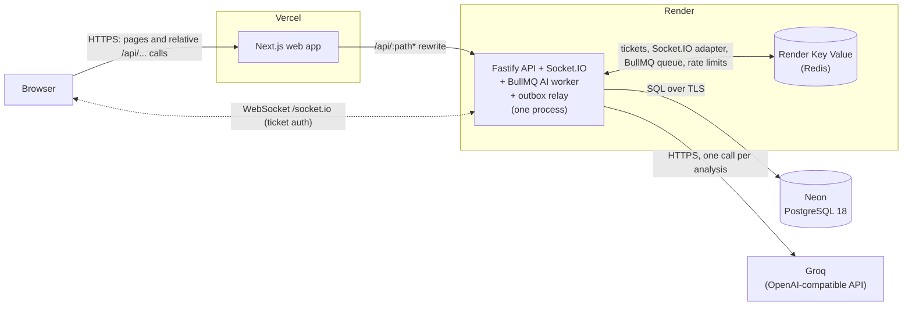
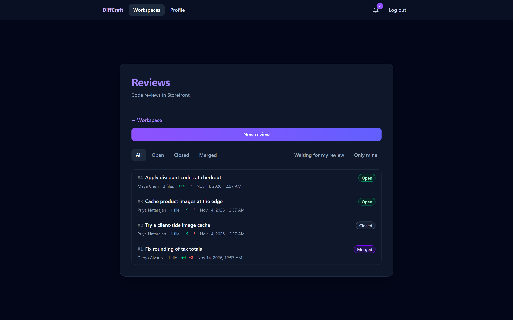
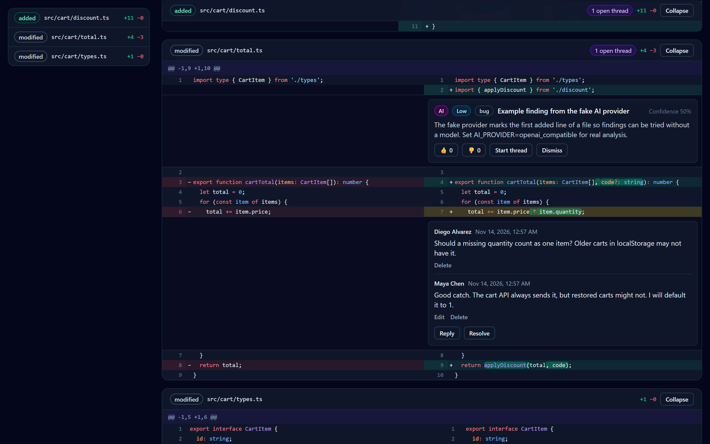
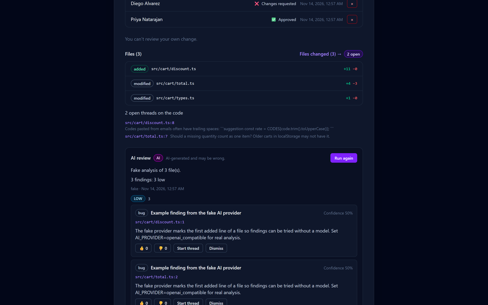
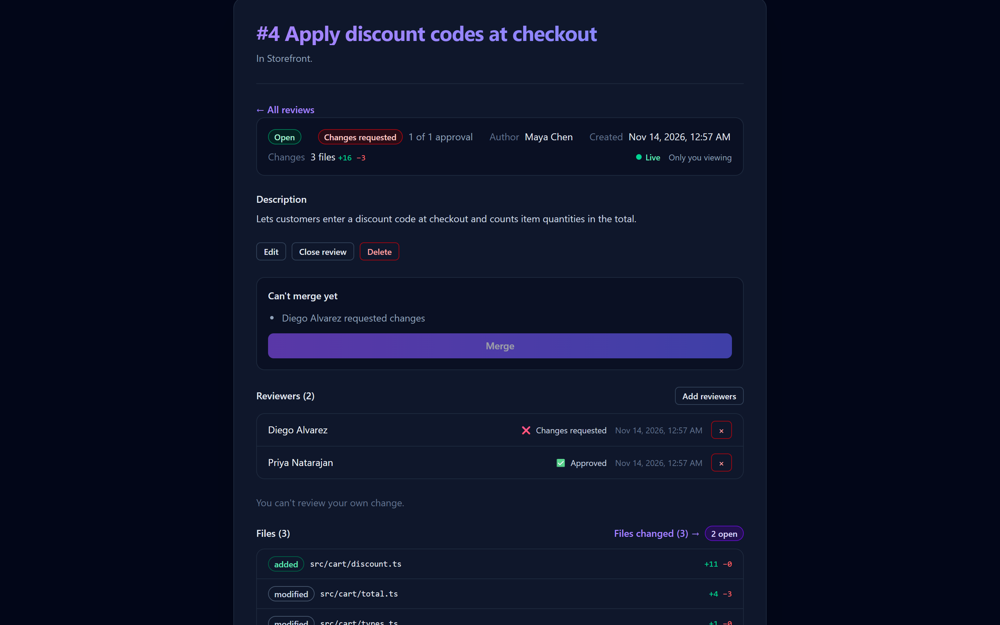
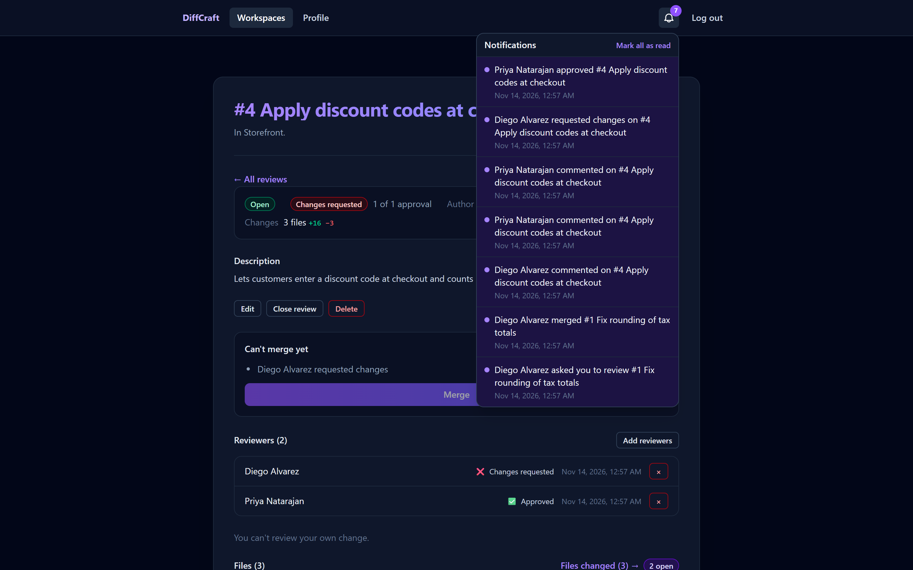

<div align="center">

# DiffCraft

**Collaborative Code Review and AI-Assisted Debugging Platform**

[](https://github.com/man-singh-dev/diffCraft/actions/workflows/ci.yml)


**Live demo:** [diffcraft-three.vercel.app](https://diffcraft-three.vercel.app)

<sub>The API runs on a free instance that sleeps after inactivity, so the first request can take about a minute.</sub>

</div>

---

DiffCraft is a code review app. You paste or upload a unified diff, read it in a unified or side-by-side viewer with syntax highlighting, discuss individual lines in threads, and approve or request changes. A review can only be merged when the workspace's rules pass. An AI review runs in the background and adds findings tied to specific lines, which reviewers rate, dismiss or turn into threads. Comments, review changes, AI status and notifications show up live for everyone viewing the review. It is a TypeScript monorepo (Next.js, Fastify, PostgreSQL, Redis), deployed on free tiers.

## Highlights

- **AI review pipeline:** BullMQ jobs backed by a Postgres row, one model call per review, Zod-validated output, every finding mapped to a real diff line or dropped, and secrets redacted before sending. ([design](docs/design/ai-analysis.md))
- **Real-time over Socket.IO + Redis adapter:** the browser connects straight to the API with a 30-second, single-use ticket (stored hashed in Redis, consumed with `GETDEL`), because the session cookie can't cross domains. ([architecture](docs/architecture.md#real-time))
- **Transactional outbox for notifications:** notification and outbox rows commit with the action itself, and a relay delivers them at least once with `FOR UPDATE SKIP LOCKED`. ([architecture](docs/architecture.md#notifications-and-the-transactional-outbox))
- **Merge rules re-checked under a row lock:** merge and decisions lock the review row (`SELECT … FOR UPDATE`), and a test races "request changes" against "merge" 25 times on a real database. ([architecture](docs/architecture.md#approvals))
- **Own diff engine:** a unified-diff parser, an LCS-based word-level diff, and Shiki syntax highlighting on the server. Large files load on demand. ([architecture](docs/architecture.md#diff-parsing))
- **Redis rate limiting + CSP with nonces:** limits per IP, email and user are shared across instances, with the real client IP forwarded from the web tier. `@fastify/helmet` runs on the API and a per-request nonce CSP on the web app. ([security](docs/security.md#rate-limiting-and-security-headers-implemented))
- **Session auth done carefully:** Argon2id, hashed session tokens in HttpOnly cookies, a CSRF Origin check, and email verification links that only verify when you press Confirm, so email scanners can't use them up. ([security](docs/security.md#authentication-implemented))
- **Tested against real infrastructure:** API integration tests run on PostgreSQL and Redis, and Playwright end-to-end tests click through the production builds (two users at once for live updates, presence and access revocation), failing on any CSP violation. ([testing](docs/development.md#testing-strategy))

---

## Features

### Reviews & diffs

- Create a review from a pasted or uploaded unified diff (UTF-8 or UTF-16, up to 1 MiB), with a live parse preview.
- Review list with status filters (open, closed, merged), "only mine", "waiting for my review" and cursor pagination.
- Edit, close, reopen and delete a review (author or admin).
- "Files changed" viewer: unified and side-by-side views, a file sidebar, server-side syntax highlighting, word-level changes, linkable line numbers, and "Load diff" for large files.

### Collaboration

- Comment threads on any diff line (old or new side) or on the review as a whole, with replies, edit, soft delete and resolve / reopen.
- Suggested-change blocks: shown as a diff, copyable, and downloadable as a patch that applies with `git apply`.
- The same permission rules in the API and the UI, from shared functions in `packages/shared`.

### Approvals

- Reviewer assignment, approve and request changes.
- Per-workspace rules (required approvals, all threads resolved), evaluated by one pure shared function.
- Merge only when the rules pass, with the blocking reasons shown, plus a review history timeline.

### Real-time & notifications

- Live comment, review and AI-status updates for everyone on the review page, with a Live / Reconnecting… / Offline indicator and a resync after reconnecting.
- "Who's viewing" presence on each review.
- In-app notifications (new thread, reply, reviewer assigned, approved, changes requested, merged, closed) in a header bell with an unread count and mark as read, delivered live.

### AI review

- "Run AI review" on an open review. Findings cover bugs, security and performance, with severity, confidence, a line reference, an explanation and an optional suggestion.
- Findings appear on the review page and inline in the diff. Members can rate them helpful or not, dismiss them, or start a comment thread from one.
- Idempotent requests, a per-workspace daily limit, retries with backoff, and a sweeper that re-enqueues lost jobs.
- Works with any OpenAI-compatible API (Groq on the live demo). Local development uses a fake provider by default, with no network calls.

### Security

- Argon2id password hashing, server-side sessions with hashed tokens in HttpOnly cookies, and a CSRF Origin check.
- Role checks on every workspace route, returning `404` to non-members. Joining a socket room re-checks membership, and sockets lose access as soon as the membership or the session ends.
- Redis-backed rate limits, `@fastify/helmet` on the API, a nonce-based Content Security Policy on the web app, and HSTS in production.
- Secret redaction before any LLM call. The provider key stays on the server and is never logged.

### Accounts & workspaces

- Sign up, log in, log out and a profile page.
- Email verification: a single-use link valid for 24 hours, a Confirm step, and "Resend email" at most once a minute.
- Workspaces with owner, admin, member and viewer roles. Admins can add, re-role and remove members, and a workspace always keeps at least one owner. Only verified users can be added.

### Planned

- Email invitations for people without an account.
- Review revisions and outdated-comment detection.
- Sign in with GitHub / Google (OAuth) and a GitHub App for importing pull requests.
- Email notifications and a daily digest.
- Search across reviews and comments.
- An evaluation set for AI prompt and model changes, and per-workspace AI settings.
- A custom domain and real email sending in production.

---

## Tech stack

| Layer     | In use now                                                                                    | Planned                     |
| --------- | --------------------------------------------------------------------------------------------- | --------------------------- |
| Frontend  | Next.js 16 (App Router), React 19, TypeScript, Tailwind CSS 4, Shiki                          |                             |
| API       | Node.js 24, Fastify 5, Zod, Argon2id (`@node-rs/argon2`), Nodemailer                          | OpenAPI generation          |
| Real-time | Socket.IO with `@socket.io/redis-adapter`                                                     |                             |
| Data      | PostgreSQL 18, Drizzle ORM, Redis (`ioredis`)                                                 |                             |
| Jobs & AI | BullMQ, the official `openai` SDK against an OpenAI-compatible LLM (Groq)                     | AI evaluation set           |
| Security  | `@fastify/rate-limit`, `@fastify/helmet`, nonce-based CSP                                     |                             |
| Tooling   | pnpm workspaces, TypeScript 6, Vitest, Playwright, ESLint, Prettier, esbuild                  |                             |
| Infra     | Docker Compose (Postgres, Redis, Mailpit), GitHub Actions, Vercel, Render (+ Key Value), Neon | Custom domain, email sender |

Rationale for each choice: [docs/architecture.md](docs/architecture.md#technology-stack).

---

## Architecture



- The browser loads pages and calls `/api/...` only on the Vercel origin. Next.js rewrites those calls to the Render API, so the session cookie belongs to the web app and HTTP needs no CORS.
- A rewrite can't carry a WebSocket upgrade, so the browser opens its Socket.IO connection **directly** to Render. It authenticates with a short-lived ticket it fetches through the rewrite.
- One Render process runs the HTTP API, the Socket.IO server, the BullMQ worker for AI jobs and the notification outbox relay. Redis (Render Key Value) holds tickets, adapter pub/sub, the job queue and rate-limit counters. PostgreSQL (Neon) is the system of record.
- The code already assumes more than one instance: the Redis adapter, `SKIP LOCKED` in the relay, and limits shared in Redis. See [scaling beyond one instance](docs/architecture.md#scaling-beyond-one-instance).

---

## Getting started from scratch

The short version. The full guide, with every environment variable, is in [docs/development.md](docs/development.md).

### 1. Prerequisites

| Tool           | Version                                    | Check            |
| -------------- | ------------------------------------------ | ---------------- |
| Node.js        | 24 (from `.nvmrc`)                         | `node --version` |
| pnpm           | 12.15.0 (`packageManager` in package.json) | `pnpm --version` |
| Docker Desktop | Any recent version with Docker Compose v2  | `docker info`    |
| Git            | Any recent version                         | `git --version`  |

Install pnpm with npm, either globally:

```bash
npm install -g pnpm@12.15.0
```

or without a global install, by writing `npx -y pnpm@12.15.0` wherever this guide says `pnpm` (for example `npx -y pnpm@12.15.0 install`). **Don't use Corepack:** it can't run pnpm 12.

### 2. Clone and configure

```bash
git clone https://github.com/man-singh-dev/diffCraft.git
cd diffCraft
```

Create `.env` from the example (skip this if you already have a `.env`, since copying would overwrite it):

```bash
# macOS / Linux (-n never overwrites)
cp -n .env.example .env
```

```powershell
# Windows PowerShell
if (-not (Test-Path .env)) { Copy-Item .env.example .env }
```

The defaults work as they are. The variables that matter most:

| Variable                   | What it is for                                                                                                                                                 |
| -------------------------- | -------------------------------------------------------------------------------------------------------------------------------------------------------------- |
| `DATABASE_URL`             | The development database (Docker Postgres). Used by the API and `pnpm db:*`. **Required.**                                                                     |
| `TEST_DATABASE_URL`        | A separate `diffcraft_test` database, created on Postgres's first start and migrated automatically before tests. Never point it at real data.                  |
| `REDIS_URL`                | Redis for realtime tickets, the Socket.IO adapter, the AI job queue, rate limits and `/ready`.                                                                 |
| `WEB_ORIGIN`               | The web app's origin (`http://localhost:3000`). The API rejects state-changing requests and sockets from any other origin.                                     |
| `NEXT_PUBLIC_REALTIME_URL` | The API origin the browser's Socket.IO client connects to (`http://localhost:4000`). Inlined when the web app starts, so restart `pnpm dev` after changing it. |
| `MAIL_TRANSPORT`           | `smtp` (default) sends email to **Mailpit** in Docker (inbox at http://localhost:8025). `log` writes emails, links included, to the API log instead.           |
| `AI_PROVIDER`              | `fake` by default: example findings, no network calls, no key. Set `openai_compatible` to use a real model (below), or `disabled` to turn AI review off.       |

**Optional: a real model with a free Groq key.** Create a key at [console.groq.com](https://console.groq.com), then set these in `.env` and restart `pnpm dev`:

```dotenv
AI_PROVIDER=openai_compatible
AI_BASE_URL=https://api.groq.com/openai/v1
AI_API_KEY=<your-groq-key>
AI_MODEL=openai/gpt-oss-120b
```

Free tiers have low rate limits and may use prompts for training, so don't send private code to them. Never commit `.env`.

### 3. Install, start the infrastructure, migrate, run

Start Docker Desktop first, then:

```bash
pnpm install
pnpm infra:up       # PostgreSQL, Redis and Mailpit in Docker (check with: docker compose ps)
pnpm db:migrate     # apply the migrations to the dev database
pnpm dev            # web on :3000 and API on :4000 together; Ctrl+C stops both
```

### 4. Check it works

| Open                         | Expect                                                       |
| ---------------------------- | ------------------------------------------------------------ |
| http://localhost:3000        | The home page, showing that the API is reachable.            |
| http://localhost:4000/health | `{"status":"ok", ...}` (the API process is up).              |
| http://localhost:4000/ready  | `{"status":"ready"}` (the API can reach Postgres and Redis). |
| http://localhost:8025        | The Mailpit inbox that catches every email the API sends.    |

Then sign up at http://localhost:3000/register. Open the "Verify your DiffCraft email address" email in Mailpit, follow the link and press **Confirm**. Create a workspace, paste a diff into a new review and press "Run AI review" to see the fake provider's findings.

### 5. Tests and checks

```bash
pnpm test           # Vitest; needs Docker running (Postgres and Redis)
pnpm typecheck
pnpm lint
pnpm format:check   # pnpm format fixes it
pnpm e2e            # Playwright end-to-end tests (Docker running; builds and starts both apps)
```

`pnpm test` migrates the test database first. Without `TEST_DATABASE_URL` the database tests are skipped, and with Redis unreachable the Redis tests are skipped. To stop the containers, run `pnpm infra:down`. Your data stays in Docker volumes.

### Troubleshooting

| Symptom                                                                      | Cause and fix                                                                                                                                                                                                                                                                                                           |
| ---------------------------------------------------------------------------- | ----------------------------------------------------------------------------------------------------------------------------------------------------------------------------------------------------------------------------------------------------------------------------------------------------------------------- |
| Sign-up or login fails with a generic error; `/ready` returns `not_ready`    | Docker isn't running, so Postgres and Redis are down. Start Docker Desktop, run `pnpm infra:up`, and check `docker compose ps`.                                                                                                                                                                                         |
| Every page that loads data fails with a 500                                  | The migrations haven't run (the API log says a relation does not exist). Run `pnpm db:migrate`.                                                                                                                                                                                                                         |
| `EADDRINUSE` / port 3000 or 4000 already in use                              | An old dev server is still running. PowerShell: `Get-NetTCPConnection -LocalPort 3000,4000 -State Listen -ErrorAction SilentlyContinue \| Select-Object -ExpandProperty OwningProcess -Unique \| ForEach-Object { Stop-Process -Id $_ -Force }`. macOS / Linux: `kill $(lsof -t -i tcp:3000 -i tcp:4000 -sTCP:LISTEN)`. |
| Live updates don't arrive; the review header shows no "Live"                 | `NEXT_PUBLIC_REALTIME_URL` is missing or wrong in `.env`. Set it to `http://localhost:4000` and restart `pnpm dev`.                                                                                                                                                                                                     |
| Corepack errors such as "Cannot find matching keyid" or a wrong pnpm version | Don't use Corepack. Run `corepack disable` and install pnpm with `npm install -g pnpm@12.15.0`, or use `npx -y pnpm@12.15.0 <command>`.                                                                                                                                                                                 |

More cases are in [docs/development.md](docs/development.md#troubleshooting).

---

## Screenshots

Captured from the real app by a Playwright project (`pnpm screenshots`) that seeds a demo workspace.

**Review list** with status filters



**Diff viewer**: side-by-side view, syntax highlighting, word-level changes, an AI finding and a comment thread on a line



**AI review** with findings from the fake provider



**Approvals**: a change request blocks the merge



**Notifications** in the header bell



---

## Roadmap

| Stage                            | Status          |
| -------------------------------- | --------------- |
| 0. Foundation                    | **Implemented** |
| 1. Database and auth             | **Implemented** |
| 2. Workspaces and roles          | **Implemented** |
| 3. Reviews and diff ingestion    | **Implemented** |
| 4. Diff viewer                   | **Implemented** |
| 5. Comments and threads          | **Implemented** |
| 6. Approvals and lifecycle       | **Implemented** |
| 7. Real-time                     | **Implemented** |
| 8. AI analysis                   | **Implemented** |
| 9. Hardening and deployment      | **In progress** |
| 10. GitHub integration and OAuth | Planned         |
| 11. Email and search             | Planned         |

- Stage 9: rate limiting, security headers and Playwright end-to-end tests are done. A custom domain is next.
- Left over from earlier stages: invitations (Stage 2), review revisions and outdated detection (Stage 5), and the AI evaluation set and per-workspace AI settings (Stage 8).

Scope of each stage: [docs/roadmap.md](docs/roadmap.md#development-roadmap).

---

## Known limitations

- **One Render instance does everything.** The API, the Socket.IO server, the AI worker and the outbox relay share one free process, with its CPU and memory. A crash or deploy takes all of them down at once, and there is no redundancy.
- **Cold starts.** The free instance sleeps after inactivity, so the first request after a quiet period can take about a minute.
- **Free-tier AI.** The provider's free tier allows only a few requests per minute, so analyses can queue or fail with a rate-limit error. Free tiers may use prompts for training: secrets are masked before sending, but the code itself is sent as-is, so don't analyze private code on the demo.
- **No real email in production yet.** Without a custom domain there is no email sender, so the live deployment writes verification links to the server log (`MAIL_TRANSPORT=log`). Locally, Mailpit catches every email.
- **Emails are sent after the commit, without retries.** If sending fails, registration still succeeds and the user can press "Resend email".
- **Email enumeration on register.** `POST /api/v1/auth/register` returns `409` for an email that is already registered, which reveals that the account exists.
- **Approval rule changes aren't broadcast.** Open review pages see a rules change only after a refresh ([details](docs/architecture.md#real-time)).
- **Rate limits depend on `WEB_PROXY_SECRET`.** Without it, the API would count every request against the web host's IP. Production refuses to start without it while limiting is on ([security](docs/security.md#the-real-client-ip)).

---

## Documentation

| File                                                     | What it covers                                                                   |
| -------------------------------------------------------- | -------------------------------------------------------------------------------- |
| [docs/README.md](docs/README.md)                         | Index of the docs folder.                                                        |
| [docs/architecture.md](docs/architecture.md)             | Components, data flow, real-time, outbox, diff engine, lifecycle, deployment.    |
| [docs/database.md](docs/database.md)                     | Tables, constraints, indexes, transactions, concurrency, pagination.             |
| [docs/api.md](docs/api.md)                               | API conventions, every endpoint, socket events and payloads.                     |
| [docs/security.md](docs/security.md)                     | Authentication, authorization, rate limiting, security headers and safeguards.   |
| [docs/development.md](docs/development.md)               | Full local setup, environment variables, Docker, project structure, testing.     |
| [docs/deployment.md](docs/deployment.md)                 | Vercel, Render and Neon setup, and the variables each host needs.                |
| [docs/design/realtime.md](docs/design/realtime.md)       | Socket.IO rooms, events, delivery guarantees and the comment broadcast sequence. |
| [docs/design/ai-analysis.md](docs/design/ai-analysis.md) | AI analysis pipeline, background jobs and failure handling.                      |
| [docs/roadmap.md](docs/roadmap.md)                       | Detailed current status, the full roadmap and future enhancements.               |

---

## Contributing

Contributions and design feedback are welcome. Open an issue first for anything non-trivial, keep each pull request to one concern, and never commit secrets.
The full guidelines are in [docs/development.md](docs/development.md#contributing).

---

## License

**License status: undecided.** No license file has been added yet. Until a license is chosen and a `LICENSE` file is committed, all rights are reserved by the author by default, and the code may not be reused without permission.
