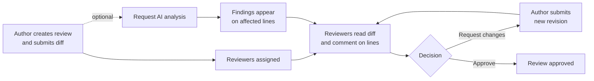
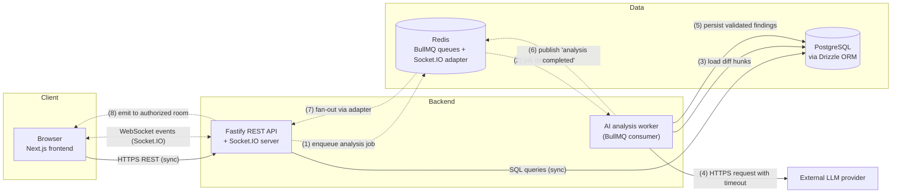
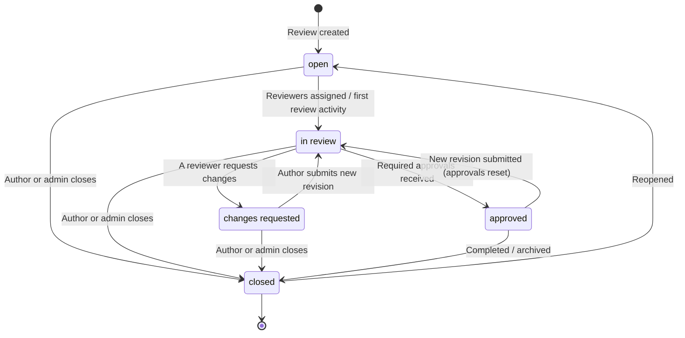
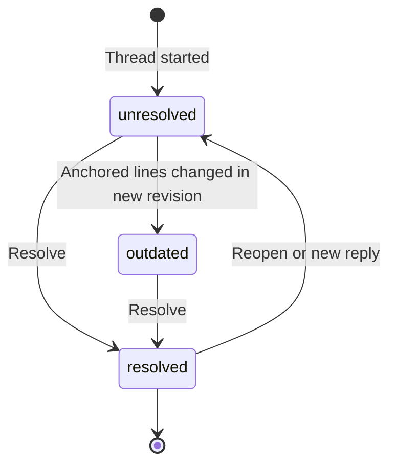
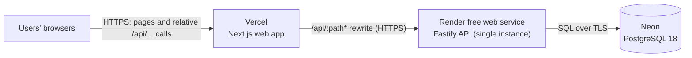
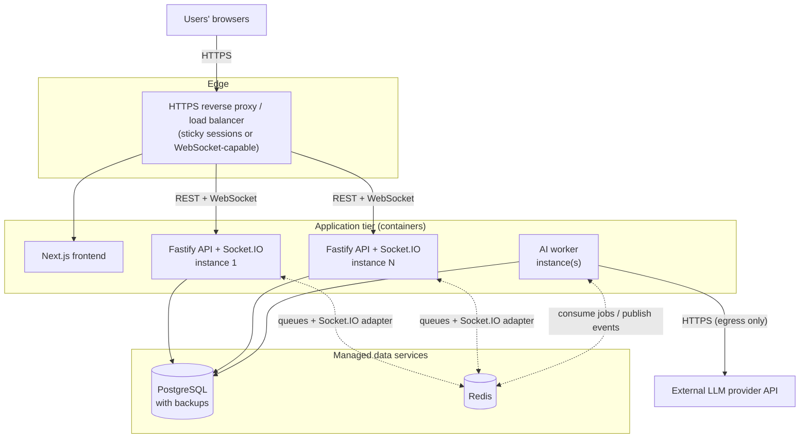

# Architecture

What DiffCraft is for, its design principles and features, how the pieces fit together, how data flows, the review lifecycle and the deployment architecture (current and future).

[← Back to README](../README.md)

---

## Overview

DiffCraft is a collaborative code review platform. It is designed to help developers understand code changes, discuss potential bugs in the context of specific lines, record review decisions, and request AI-assisted analysis of the changed code — all within a single workspace.

The goal is to bring four things that are usually scattered across tools into one place:

1. **The diff** — what changed, file by file and line by line.
2. **The discussion** — threaded, line-anchored conversations about those changes.
3. **The decision** — reviewer assignments, approvals, change requests and review status.
4. **The analysis** — structured, AI-generated findings that point to specific files and lines and are reviewed by humans like any other comment.

DiffCraft is **not** an AI chatbot or a code generator. The AI component is one input into a human-led review process: it produces suggestions that reviewers verify, discuss and either act on or dismiss.

The project is also intended as a deliberate exercise in backend engineering: relational data modeling, authorization, reliable real-time updates, asynchronous job processing and safe integration of an external LLM provider.

---

## Problem Statement

Code review is where many defects are caught, but the process has recurring friction:

- **Context is fragmented.** Diffs, discussion, CI output and ad-hoc analysis often live in different tools, so reviewers spend effort reassembling context.
- **Discussion drifts from the code.** Comments that are not anchored to lines (or become stale after a new revision) are hard to follow and easy to lose.
- **Review state is ambiguous.** It is not always clear who still needs to review, which threads are unresolved, or whether a change request has been addressed.
- **Automated analysis is hard to trust and hard to act on.** Unstructured AI output ("this looks fine", or a wall of text) is difficult to verify, cannot be tracked, and is not tied to specific lines.

DiffCraft aims to address these by modeling reviews, line-anchored threads, review decisions and AI findings as first-class, related data — and by delivering updates to participants in real time.

---

## Goals and Design Principles

| Principle                                  | What it means in practice                                                                                                                        |
| ------------------------------------------ | ------------------------------------------------------------------------------------------------------------------------------------------------ |
| **Humans make the decisions**              | AI findings are suggestions with a severity, category and explanation. They never approve, reject or block a review on their own.                |
| **Everything is anchored**                 | Comments and findings reference a review, a file, a revision and a line range, so they can be located and marked outdated when the code changes. |
| **The database is the source of truth**    | Real-time events are notifications about committed state, never a substitute for it. Clients can always recover by re-fetching over HTTP.        |
| **Slow work happens off the request path** | LLM calls run in a background worker. HTTP requests return quickly with a job reference.                                                         |
| **Validate at every boundary**             | Request bodies, query parameters, socket payloads, environment configuration and model output are all validated with Zod schemas.                |
| **Authorize every resource access**        | Authentication alone is not sufficient; every read and write is checked against workspace membership and role.                                   |
| **Fail visibly and recoverably**           | Jobs have explicit states, bounded retries, timeouts and recorded failure reasons.                                                               |
| **Shared contracts**                       | Request/response and event schemas live in a shared package used by both frontend and backend, reducing drift.                                   |
| **Honest documentation**                   | The README distinguishes what exists from what is planned.                                                                                       |

---

## Key Features

All features below are **Planned** unless marked otherwise. So far only user authentication is **Implemented**.

### Code Diff Viewer

- Side-by-side and unified diff views.
- Highlighting of added and removed lines.
- File-level change navigation (file tree with per-file addition/deletion counts).
- Stable line-number references (old side / new side) used by comments and AI findings.

### Collaborative Code Review

- Review sessions containing one or more changed files.
- Line-level and line-range comments.
- Threaded discussions via replies.
- Thread resolution and reopening, tracked independently of review approval.
- Approve / request-changes workflow.
- Review status tracking across revisions.

### Real-Time Collaboration

- Live comment, reply and resolution updates.
- Live review status and approval updates.
- In-app notifications (mentions, assignments, completed analyses).
- Reviewer presence indicators per review.
- Socket.IO-based transport with authorized rooms.

### AI-Assisted Code Analysis

- Potential bug detection.
- Security issue identification.
- Performance suggestions.
- Code quality feedback.
- Natural-language summaries of a change.
- Structured findings: **severity**, **category**, **explanation**, **suggested fix (optional)**, **file and line references**, and a **confidence** indicator.

> [!NOTE]
> AI findings are generated by a language model and can be incorrect, incomplete or irrelevant. They are presented as suggestions that require verification by a reviewer, not as guaranteed diagnoses. Reviewers can dismiss a finding or promote it into a discussion thread.

### Review Management

- Reviewer assignments and reassignment.
- Unresolved-thread tracking per review and per reviewer.
- Review history (status changes, approvals, revisions, analyses).
- Filters by status, author, assignee and workspace.
- Workspace-level collaboration.

### Authentication and Authorization

- User authentication: email/password sign-up, login, logout and server-side sessions. **Implemented.**
- Workspace membership with invitations.
- Role-based access control at the workspace level.
- Resource-level authorization checks on every protected endpoint and socket room.

---

## Product Workflow

1. An author creates a review in a workspace and submits a diff (initially as a unified diff / patch upload; Git provider integration is a future enhancement).
2. The author assigns reviewers. Assigned reviewers are notified in real time.
3. Reviewers navigate the diff and leave line-anchored comments; others reply in threads.
4. Any participant with permission may request an AI analysis. The request is processed in the background, and findings appear on the relevant lines once ready.
5. Reviewers resolve threads, dismiss or discuss findings, and record a decision: **approve** or **request changes**.
6. If changes are requested, the author submits a new revision. Comments on changed lines are marked outdated, and the review returns to _in review_.

---

## High-Level Architecture

DiffCraft is designed as a small set of cooperating services sharing a PostgreSQL database and a Redis instance:

- A **Next.js frontend** that renders the diff viewer and review UI.
- A **Fastify API** that owns all reads and writes, enforces authorization and hosts the Socket.IO server.
- A **background worker** that processes AI analysis jobs from a BullMQ queue.
- **PostgreSQL** as the system of record; **Redis** as the job queue backend and Socket.IO pub/sub adapter.
- An **external LLM provider**, reachable only from the worker.

### Architecture diagram (proposed)

Solid arrows are **synchronous** request/response interactions. Dashed arrows are **asynchronous** (queued work, pub/sub, pushed events).

**Why this shape:**

- **Fastify** gives fast request handling, a first-class plugin/encapsulation model for auth and DB decorators, and schema-driven routes that pair well with Zod and OpenAPI generation.
- **A separate worker process** keeps slow, failure-prone LLM calls off the API's event loop and allows the worker to be scaled or restarted independently.
- **BullMQ on Redis** provides durable jobs, retries with backoff, job IDs for de-duplication and visibility into failed jobs, without introducing an additional broker.
- **Socket.IO's Redis adapter** lets multiple API instances — and the worker — broadcast to the same rooms, so real-time delivery does not depend on which instance a client is connected to.
- **PostgreSQL** fits the strongly relational domain (workspaces → reviews → files → threads) and provides transactions, foreign keys, partial indexes and row locking needed for consistent review state.

---

## Component Responsibilities

| Component                                           | Responsibilities                                                                                                                                                                                                      | Does **not** do                                                    |
| --------------------------------------------------- | --------------------------------------------------------------------------------------------------------------------------------------------------------------------------------------------------------------------- | ------------------------------------------------------------------ |
| **Web (`apps/web`)**                                | Rendering diffs, comment threads, findings and review state; optimistic UI where safe; subscribing to review rooms; re-fetching on reconnect.                                                                         | Authorization decisions, direct DB or LLM access, holding secrets. |
| **API (`apps/api`)**                                | Authentication, authorization, Zod validation, business rules (state transitions, approvals), persistence, enqueueing jobs, Socket.IO handshake auth and room membership, emitting events after commit, OpenAPI docs. | Calling the LLM provider; long-running work.                       |
| **Worker (`apps/worker` or API worker entrypoint)** | Consuming analysis jobs, assembling bounded prompt context from diff hunks, redacting likely secrets, calling the LLM with timeouts, validating output, persisting findings, publishing completion events.            | Serving HTTP; accepting user input directly.                       |
| **Shared (`packages/shared`)**                      | Zod schemas for requests, responses, socket events and AI findings; shared enums (roles, statuses, severities); TypeScript types inferred from schemas.                                                               | Runtime I/O.                                                       |
| **PostgreSQL**                                      | System of record for users, workspaces, reviews, comments, approvals, jobs and findings.                                                                                                                              |                                                                    |
| **Redis**                                           | BullMQ queues, Socket.IO adapter pub/sub, rate-limit counters, presence TTL keys.                                                                                                                                     | Durable business data.                                             |
| **LLM provider**                                    | Producing structured analysis from bounded diff context.                                                                                                                                                              | Being trusted: its output is validated before use.                 |

---

## Technology Stack

**In use now:** Next.js, TypeScript, Tailwind CSS, Node.js, Fastify (with `@fastify/cookie`), Zod, PostgreSQL with Drizzle ORM (schema, migrations and the `pg` driver), Argon2id (`@node-rs/argon2`), esbuild (API production bundle), Vitest, Docker (local PostgreSQL and Redis), GitHub Actions CI, and Vercel, Render and Neon for deployment.

**Planned:** Socket.IO, BullMQ, the LLM provider integration and OpenAPI generation. Redis runs locally but no application code uses it until Stage 7.

| Layer            | Technology                                    | Rationale                                                                                                            |
| ---------------- | --------------------------------------------- | -------------------------------------------------------------------------------------------------------------------- |
| Frontend         | **Next.js**, **TypeScript**, **Tailwind CSS** | Component model suited to a complex review UI; type sharing with backend; utility CSS keeps diff styling consistent. |
| API              | **Node.js**, **Fastify**, **TypeScript**      | Low-overhead HTTP server with plugin encapsulation and schema-based routes.                                          |
| Validation       | **Zod**                                       | One schema definition for runtime validation, TypeScript types and OpenAPI generation; also used for LLM output.     |
| Database         | **PostgreSQL**                                | Relational integrity, transactions, partial/compound indexes, `SELECT … FOR UPDATE`.                                 |
| ORM / migrations | **Drizzle ORM**                               | Typed, SQL-close query builder with parameterized queries and versioned migrations.                                  |
| Real-time        | **Socket.IO**                                 | Rooms, acknowledgements, reconnection handling and a Redis adapter for multi-instance fan-out.                       |
| Background jobs  | **Redis**, **BullMQ**                         | Durable queues, retries with backoff, job de-duplication by ID, concurrency control.                                 |
| AI               | Server-side LLM provider integration          | Provider abstracted behind an interface so models/providers can be swapped and mocked in tests.                      |
| Testing          | **Vitest**                                    | Fast TypeScript-native test runner for unit and integration tests.                                                   |
| API docs         | **OpenAPI**                                   | Generated from route schemas so documentation tracks the code.                                                       |
| Infrastructure   | **Docker**, **GitHub Actions**                | Reproducible local services and automated checks.                                                                    |

---

## Data Flow

### Synchronous path — reading and writing review data

1. The browser calls the API over HTTPS with a session cookie.
2. Fastify's auth plugin resolves the user; a route-level guard loads the target resource and checks workspace membership and role.
3. The request is validated with Zod.
4. Drizzle executes parameterized queries in a transaction when multiple rows change.
5. After commit, the API emits a Socket.IO event to the relevant room and returns the HTTP response.

### Asynchronous path — AI analysis

1. A client requests analysis; the API validates input and permissions.
2. The API inserts an `ai_analysis_jobs` row (status `queued`) and enqueues a BullMQ job whose ID is derived from the job's idempotency key.
3. The API returns `202 Accepted` with the job ID.
4. The worker loads the relevant diff hunks, calls the LLM provider, validates the response, and writes findings and the job's final status in one transaction.
5. The worker publishes a completion event; the API's Socket.IO adapter delivers it to authorized clients, which then fetch findings over HTTP.

### Recovery path

On reconnect, the client re-joins its rooms and re-fetches the review state over HTTP. Events are treated as hints to refresh rather than as the only copy of the data, so missed events do not cause permanent inconsistency.

---

## Diff Parsing

**Implemented** (no routes use it yet). `parsePatch(text, limits?)` in `packages/shared/src/diff/` turns a unified diff into files → hunks → lines, with the old and new line number of every line. It is pure code with no I/O, so the API can validate uploads with it and the web app can render the same structure. The result types are Zod schemas (`ParsedPatchSchema`), so stored or transferred diffs can be validated too.

**Supported input:** `git diff` and `git format-patch` output (new, deleted, renamed and copied files, mode-only changes, binary files, quoted paths such as `"a/caf\303\251 menu.txt"`) and plain `diff -u` output. LF and CRLF line endings, `\ No newline at end of file`, omitted hunk counts (`@@ -3 +3 @@` means one line) and text between files (commit messages, diffstats) are handled. Binary contents are not decoded; the file is just marked `isBinary`.

**Limits** (each can be overridden per call):

| Limit               | Default |
| ------------------- | ------- |
| Patch size          | 1 MB    |
| Files               | 300     |
| Diff lines in total | 20,000  |
| Characters per line | 5,000   |

The size limit is checked before any parsing, so an oversized upload costs almost nothing. Anything the parser can't trust throws a `DiffParseError` with a short `code` (`empty_patch`, `too_large`, `count_mismatch`, …) and the 1-based `line` it failed on, ready to show to the user.

**Why the hunk counts are trusted:** a hunk's lines are read by the counts in its `@@ -a,b +c,d @@` header, not by guessing from line prefixes. A removed SQL comment (`-- note`) appears in the patch as `--- note`, and an added `++i;` as `+++i;`, which look exactly like file headers. Counting is how `git apply` and `patch` read hunks, so the parser agrees with them; if the lines don't match the counts, the patch is rejected (`count_mismatch`) instead of being guessed at. The regular expressions are anchored with bounded repeats, so parsing time stays linear on hostile input.

---

## Review Lifecycle

Review status and comment resolution are **independent**. Resolving every thread does not approve a review, and approving a review does not resolve threads (although a workspace setting could later require all threads to be resolved before approval).

### Review status (proposed)

### Comment thread state (separate lifecycle)

Status recomputation rules (proposed):

- Any `changes_requested` decision on the current revision → `changes_requested`.
- Otherwise, the required number of `approved` decisions on the current revision → `approved`.
- A new revision resets decisions (they remain in history) and moves the review to `in_review`.

---

## Deployment Architecture

### Current deployment (Implemented)

- The browser only ever talks to the Vercel origin. Next.js rewrites `/api/:path*` to the Render API (`API_URL`), so the session cookie belongs to the web app's origin and no CORS is needed.
- The API is a single free Render instance. It sleeps after inactivity (cold starts of about a minute) and applies pending migrations on start (`start:prod`).
- Neon hosts PostgreSQL 18; the API uses its direct (non-pooled) connection string.
- No Redis and no worker are deployed yet.

### Future architecture (Planned)

> **Planned, not deployed.** This is the target once real-time (Stage 7) and AI analysis (Stage 8) need several API instances, Redis and a worker.

Notes:

- Only the worker needs outbound access to the LLM provider and holds its API key.
- Socket.IO across multiple API instances requires the Redis adapter and either sticky sessions or WebSocket-only transport.
- Migrations run as a separate release step, not on application start (unlike the current single-instance setup).
