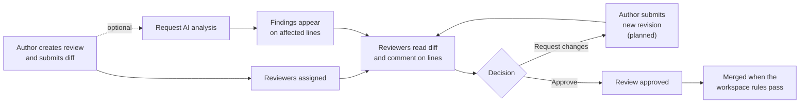
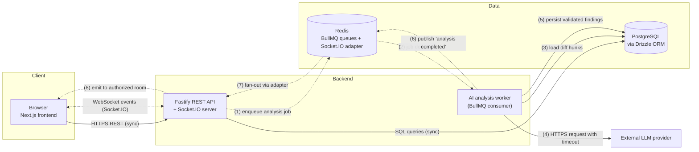
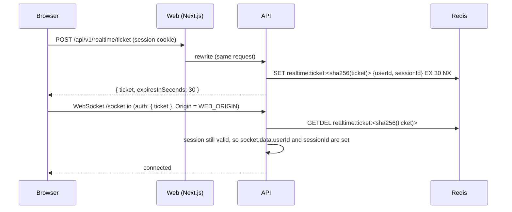
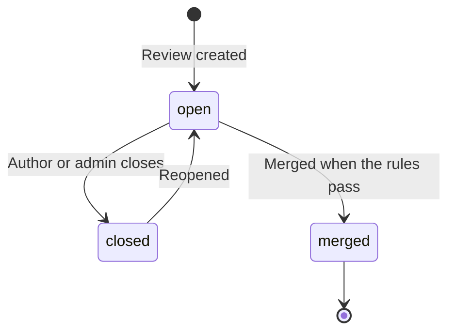
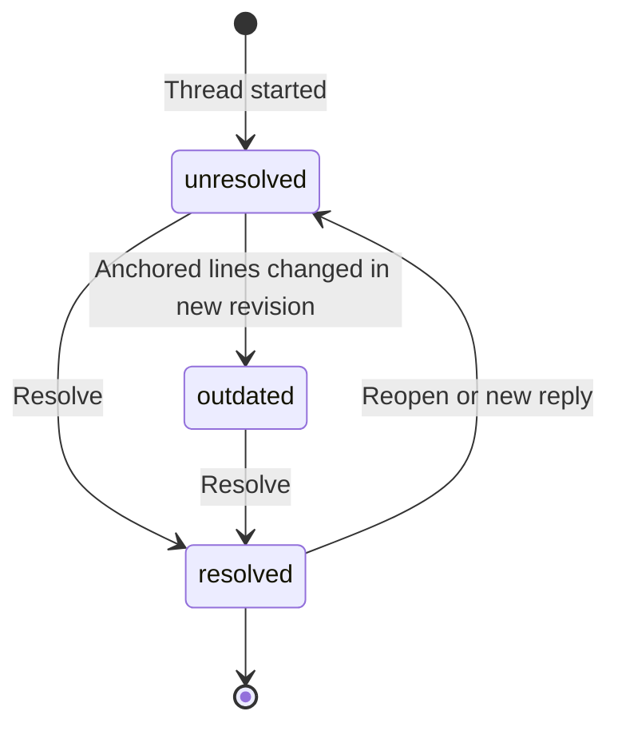
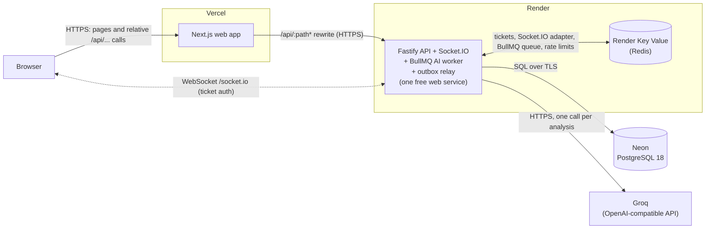
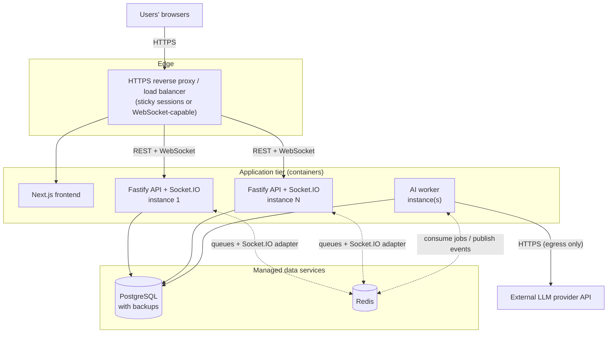

# Architecture

What DiffCraft is for, its design principles and features, how the pieces fit together, how data flows, the review lifecycle and the deployment architecture (current, and how it scales).

[← Back to README](../README.md)

---

## Overview

DiffCraft is a collaborative code review platform. It is designed to help developers understand code changes, discuss potential bugs in the context of specific lines, record review decisions, and request AI-assisted analysis of the changed code — all within a single workspace.

The goal is to bring four things that are usually scattered across tools into one place:

1. **The diff** — what changed, file by file and line by line.
2. **The discussion** — threaded, line-anchored conversations about those changes.
3. **The decision** — reviewer assignments, approvals, change requests and review status.
4. **The analysis** — structured, AI-generated findings that point to specific files and lines and are reviewed by humans like any other comment.

DiffCraft is **not** an AI chatbot or a code generator. The AI component is one input into a human-led review process: it produces suggestions that reviewers verify, discuss and either act on or dismiss.

The project is also intended as a deliberate exercise in backend engineering: relational data modeling, authorization, reliable real-time updates, asynchronous job processing and safe integration of an external LLM provider.

---

## Problem Statement

Code review is where many defects are caught, but the process has recurring friction:

- **Context is fragmented.** Diffs, discussion, CI output and ad-hoc analysis often live in different tools, so reviewers spend effort reassembling context.
- **Discussion drifts from the code.** Comments that are not anchored to lines (or become stale after a new revision) are hard to follow and easy to lose.
- **Review state is ambiguous.** It is not always clear who still needs to review, which threads are unresolved, or whether a change request has been addressed.
- **Automated analysis is hard to trust and hard to act on.** Unstructured AI output ("this looks fine", or a wall of text) is difficult to verify, cannot be tracked, and is not tied to specific lines.

DiffCraft aims to address these by modeling reviews, line-anchored threads, review decisions and AI findings as first-class, related data — and by delivering updates to participants in real time.

---

## Goals and Design Principles

| Principle                                  | What it means in practice                                                                                                                        |
| ------------------------------------------ | ------------------------------------------------------------------------------------------------------------------------------------------------ |
| **Humans make the decisions**              | AI findings are suggestions with a severity, category and explanation. They never approve, reject or block a review on their own.                |
| **Everything is anchored**                 | Comments and findings reference a review, a file, a revision and a line range, so they can be located and marked outdated when the code changes. |
| **The database is the source of truth**    | Real-time events are notifications about committed state, never a substitute for it. Clients can always recover by re-fetching over HTTP.        |
| **Slow work happens off the request path** | LLM calls run in a background worker. HTTP requests return quickly with a job reference.                                                         |
| **Validate at every boundary**             | Request bodies, query parameters, socket payloads, environment configuration and model output are all validated with Zod schemas.                |
| **Authorize every resource access**        | Authentication alone is not sufficient; every read and write is checked against workspace membership and role.                                   |
| **Fail visibly and recoverably**           | Jobs have explicit states, bounded retries, timeouts and recorded failure reasons.                                                               |
| **Shared contracts**                       | Request/response and event schemas live in a shared package used by both frontend and backend, reducing drift.                                   |
| **Honest documentation**                   | The README distinguishes what exists from what is planned.                                                                                       |

---

## Key Features

Everything below is **Implemented** unless marked _(planned)_. The roadmap's [current status](roadmap.md#current-status) table has the details.

### Code Diff Viewer

- Side-by-side and unified diff views.
- Highlighting of added and removed lines.
- File-level change navigation (file tree with per-file addition/deletion counts).
- Stable line-number references (old side / new side) used by comments and AI findings.

### Collaborative Code Review

- Review sessions containing one or more changed files.
- Line-level comments, on either side of the diff, and review-level comments (line ranges _(planned)_).
- Threaded discussions via replies.
- Thread resolution and reopening, tracked independently of review approval.
- Approve / request-changes workflow.
- Review status tracking across revisions _(planned, with revisions)_.

### Real-Time Collaboration

- Live comment, reply and resolution updates.
- Live review status and approval updates.
- In-app notifications for new threads, replies, assignments, decisions, merges and closes (mentions and completed analyses _(planned)_).
- "Who's viewing" presence per review.
- Socket.IO transport with ticket authentication and authorized rooms.

### AI-Assisted Code Analysis

- Potential bug detection.
- Security issue identification.
- Performance suggestions.
- Code quality feedback _(planned; findings cover bugs, security and performance today)_.
- Natural-language summaries of a change.
- Structured findings: **severity**, **category**, **title**, **explanation**, **suggested fix (optional)**, **file and line references**, and a **confidence** indicator.

> [!NOTE]
> AI findings are generated by a language model and can be incorrect, incomplete or irrelevant. They are presented as suggestions that require verification by a reviewer, not as guaranteed diagnoses. Reviewers can dismiss a finding or promote it into a discussion thread.

### Review Management

- Reviewer assignments and reassignment.
- Unresolved-thread tracking per review (one of the merge rules).
- Review history (reviewer changes, decisions, status changes, merge; revisions _(planned)_).
- Filters by status, "only mine" (author) and "waiting for my review" (assigned reviewer), per workspace.
- Workspace-level collaboration.

### Authentication and Authorization

- User authentication: email/password sign-up, login, logout, email verification and server-side sessions.
- Workspace membership managed by admins (email invitations _(planned)_).
- Role-based access control at the workspace level.
- Resource-level authorization checks on every protected endpoint and socket room.

---

## Product Workflow



1. An author creates a review in a workspace and submits a diff (initially as a unified diff / patch upload; GitHub pull request import is planned for Stage 10).
2. The author assigns reviewers. Assigned reviewers get an in-app notification, delivered live.
3. Reviewers navigate the diff and leave line-anchored comments; others reply in threads.
4. Any participant with permission may request an AI analysis. The request is processed in the background, and findings appear on the relevant lines once ready.
5. Reviewers resolve threads, dismiss or discuss findings, and record a decision: **approve** or **request changes**.
6. When the workspace's rules pass, the author or an admin merges the review. _(Planned:)_ if changes are requested, the author submits a new revision, comments on changed lines are marked outdated, and decisions reset.

---

## High-Level Architecture

DiffCraft is designed as a small set of cooperating services sharing a PostgreSQL database and a Redis instance:

- A **Next.js frontend** that renders the diff viewer and review UI.
- A **Fastify API** that owns all reads and writes, enforces authorization and hosts the Socket.IO server.
- A **background worker** that processes AI analysis jobs from a BullMQ queue. Today it runs inside the API process.
- **PostgreSQL** as the system of record; **Redis** as the job queue backend and Socket.IO pub/sub adapter.
- An **external LLM provider**, reachable only from the worker.

### Logical architecture

The worker is drawn separately because it is a separate concern; in the current deployment it runs in the same process as the API (see [Deployment Architecture](#deployment-architecture)).

Solid arrows are **synchronous** request/response interactions. Dashed arrows are **asynchronous** (queued work, pub/sub, pushed events).



**Why this shape:**

- **Fastify** gives fast request handling, a first-class plugin/encapsulation model for auth and DB decorators, and schema-driven routes that pair well with Zod and OpenAPI generation.
- **A worker separate from the request path** keeps slow, failure-prone LLM calls out of HTTP requests. It runs in the API process today to fit one free instance, and can move to its own process without changing the job logic.
- **BullMQ on Redis** provides durable jobs, retries with backoff, job IDs for de-duplication and visibility into failed jobs, without introducing an additional broker.
- **Socket.IO's Redis adapter** lets multiple API instances — and the worker — broadcast to the same rooms, so real-time delivery does not depend on which instance a client is connected to.
- **PostgreSQL** fits the strongly relational domain (workspaces → reviews → files → threads) and provides transactions, foreign keys, partial indexes and row locking needed for consistent review state.

---

## Component Responsibilities

| Component                                        | Responsibilities                                                                                                                                                                                                                       | Does **not** do                                                    |
| ------------------------------------------------ | -------------------------------------------------------------------------------------------------------------------------------------------------------------------------------------------------------------------------------------- | ------------------------------------------------------------------ |
| **Web (`apps/web`)**                             | Rendering diffs, comment threads, findings and review state; optimistic UI where safe; subscribing to review rooms; re-fetching on reconnect.                                                                                          | Authorization decisions, direct DB or LLM access, holding secrets. |
| **API (`apps/api`)**                             | Authentication, authorization, Zod validation, business rules (state transitions, approvals), persistence, enqueueing jobs, Socket.IO handshake auth and room membership, emitting events after commit, the notification outbox relay. | Calling the LLM provider; long-running work.                       |
| **AI worker (in the API process, `modules/ai`)** | Consuming analysis jobs, assembling bounded prompt context from diff hunks, redacting likely secrets, calling the LLM with timeouts, validating output, persisting findings, publishing completion events.                             | Serving HTTP; accepting user input directly.                       |
| **Shared (`packages/shared`)**                   | Zod schemas for requests, responses, socket events and AI findings; shared enums (roles, statuses, severities); TypeScript types inferred from schemas.                                                                                | Runtime I/O.                                                       |
| **PostgreSQL**                                   | System of record for users, workspaces, reviews, comments, approvals, jobs and findings.                                                                                                                                               |                                                                    |
| **Redis**                                        | BullMQ queues, Socket.IO adapter pub/sub, rate-limit counters, single-use realtime tickets.                                                                                                                                            | Durable business data.                                             |
| **LLM provider**                                 | Producing structured analysis from bounded diff context.                                                                                                                                                                               | Being trusted: its output is validated before use.                 |

---

## Technology Stack

**In use now:** Next.js, TypeScript, Tailwind CSS, Shiki, Node.js, Fastify (with `@fastify/cookie`, `@fastify/rate-limit` and `@fastify/helmet`), Zod, PostgreSQL with Drizzle ORM (schema, migrations and the `pg` driver), Argon2id (`@node-rs/argon2`), Redis (`ioredis`), Socket.IO with `@socket.io/redis-adapter`, BullMQ, the official `openai` SDK (pointed at any OpenAI-compatible provider; Groq in production), Nodemailer, esbuild (API production bundle), Vitest, Docker (local PostgreSQL, Redis and Mailpit), GitHub Actions CI, and Vercel, Render and Neon for deployment.

**Planned:** OpenAPI generation, Playwright end-to-end tests.

| Layer            | Technology                                    | Rationale                                                                                                            |
| ---------------- | --------------------------------------------- | -------------------------------------------------------------------------------------------------------------------- |
| Frontend         | **Next.js**, **TypeScript**, **Tailwind CSS** | Component model suited to a complex review UI; type sharing with backend; utility CSS keeps diff styling consistent. |
| API              | **Node.js**, **Fastify**, **TypeScript**      | Low-overhead HTTP server with plugin encapsulation and schema-based routes.                                          |
| Validation       | **Zod**                                       | One schema definition for runtime validation, TypeScript types and OpenAPI generation; also used for LLM output.     |
| Database         | **PostgreSQL**                                | Relational integrity, transactions, partial/compound indexes, `SELECT … FOR UPDATE`.                                 |
| ORM / migrations | **Drizzle ORM**                               | Typed, SQL-close query builder with parameterized queries and versioned migrations.                                  |
| Real-time        | **Socket.IO**                                 | Rooms, acknowledgements, reconnection handling and a Redis adapter for multi-instance fan-out.                       |
| Background jobs  | **Redis**, **BullMQ**                         | Durable queues, retries with backoff, job de-duplication by ID, concurrency control.                                 |
| AI               | **`openai` SDK**, OpenAI-compatible provider  | Provider abstracted behind an interface so models/providers can be swapped and mocked in tests.                      |
| Testing          | **Vitest**                                    | Fast TypeScript-native test runner for unit and integration tests.                                                   |
| API docs         | **OpenAPI** _(planned)_                       | Generated from route schemas so documentation tracks the code.                                                       |
| Infrastructure   | **Docker**, **GitHub Actions**                | Reproducible local services and automated checks.                                                                    |

---

## Data Flow

### Synchronous path — reading and writing review data

1. The browser calls the API over HTTPS with a session cookie.
2. Fastify's auth plugin resolves the user; a route-level guard loads the target resource and checks workspace membership and role.
3. The request is validated with Zod.
4. Drizzle executes parameterized queries in a transaction when multiple rows change.
5. After commit, the API emits a Socket.IO event to the relevant room and returns the HTTP response.

### Asynchronous path — AI analysis

**Implemented** (backend Stage 8A; web UI and feedback Stage 8B). Details: [design/ai-analysis.md](design/ai-analysis.md).

1. A client requests analysis; the API checks membership, that AI is enabled and that the review is open.
2. In one transaction the API returns the active job with the same idempotency key if there is one, checks the workspace's daily limit and inserts an `ai_analysis_jobs` row (status `queued`).
3. After the commit it enqueues a BullMQ job whose ID is the job's ID and returns `202 Accepted` with the job.
4. The worker (inside the API process) claims the job with a conditional update, loads the diff hunks, builds bounded and redacted context, makes one model call, validates and maps the output, and writes findings and the final status in one transaction.
5. The worker publishes `analysis:status` / `analysis:completed` to the review room; clients fetch findings over HTTP.
6. Reviewers see the findings on the review page and inline in the diff, rate them helpful or not, dismiss them, or start a comment thread from one.

### Recovery path

On reconnect, the client re-joins its rooms and re-fetches the review state over HTTP. Events are treated as hints to refresh rather than as the only copy of the data, so missed events do not cause permanent inconsistency.

---

## Real-time

**Implemented** (Stage 7, steps 1–5a: tickets, the Socket.IO server, review rooms, the Redis adapter, events for comments, approvals and review changes, live updates in the web app, presence, and in-app notifications with a transactional outbox and a header bell).

**Why tickets.** In production the web app (Vercel) and the API (Render) are on different domains. The web app reaches the API through a `/api/*` rewrite, but a rewrite can't carry a WebSocket upgrade, and the session cookie belongs to the web app's domain, so the browser can't send it to the API directly. The socket therefore connects straight to the API and proves who it is with a short-lived, single-use **ticket**:



- **Transport: WebSocket only.** Long polling spreads one session over many HTTP requests, which would need sticky sessions across API instances; one WebSocket stays on the instance it reached.
- **Rooms.** A client sends `review:join` `{ workspaceId, reviewNumber }`. The server checks membership (`getMembership`, viewer or higher) and loads the review **within that workspace** (`getReviewByNumber`), the same service functions the HTTP routes use, then joins `review:<reviewId>` and acknowledges `{ ok: true, reviewId }`. A missing review and a workspace you aren't in both get `{ ok: false, error: 'not_found' }`. `review:leave` `{ reviewId }` leaves the room. Each socket can be in at most 20 review rooms and may attempt 10 joins per 10 s (`rate_limited`).
- **Losing access.** Each socket records the workspace of every review room it joined (`socket.data.reviewRooms`). Removing a member, leaving or deleting a workspace evicts the affected sockets from that workspace's rooms on every instance (acknowledged through `serverSideEmitWithAck` before the HTTP response) and sends them `review:access-revoked`; logout disconnects the sockets of that session; every 5 minutes each instance re-checks its sockets' memberships and sessions in one query. See [security](security.md#continuous-authorization-for-sockets-implemented).
- **Emitting.** `app.realtime.emitToReview(reviewId, event, payload)` emits to the room. Event names and Zod schemas live in `packages/shared/src/realtime.ts` (`ReviewRoomEventSchemas`, `ReviewRoomEvents`).
- **Several API instances.** `@socket.io/redis-adapter` publishes every room emit on Redis (one publisher and one subscriber connection per instance, separate from the main client), so a socket on instance A receives an event emitted on instance B. An instance joins only once it listens.
- **Delivery is at most once.** Events aren't stored or replayed: a socket that is disconnected, or an instance that can't reach Redis (it then delivers to its own sockets only), misses them. Events are hints that something changed. After reconnecting, a client gets a new ticket, re-joins its rooms and re-fetches over HTTP (the [recovery path](#recovery-path)).
- **Domain events.** Every payload has `reviewId`, `actorId` and `at`; the payloads and the routes that emit them are listed in [api.md](api.md#real-time-events).
  - `thread:upsert` `{ thread }` after a thread is created, replied to, edited, has a comment deleted, or is resolved/reopened.
  - `review:changed` `{ reason }` with `reviewers`, `decision`, `merged`, `status` (closed/reopened) or `updated` (title/description).
  - `review:deleted` after a review is deleted.
- **After commit.** The services commit their own transactions; the route calls the publisher (`modules/realtime/publish.ts`) only once the service has returned successfully, so a failed or rolled-back request emits nothing and an event never describes uncommitted data. `publishThread` re-reads the thread with `getThread` in a read-only `repeatable read` transaction whose first statement reads `clock_timestamp()`, so `at` and the thread come from the same snapshot; if the thread is gone, nothing is emitted.
- **Best effort.** A publish failure (the read or the emit) is caught and logged with the error name and message only, never a payload or comment body, and the HTTP response is unaffected. The route awaits the publish, so events from one client's sequential requests leave in order.
- **Last writer wins by `at`.** `at` comes from the database clock, not an instance's clock, so it is comparable across instances. Events can still arrive out of order (two instances, two Redis publishes), so a client keeps the copy with the latest `at` and ignores an older event. `review:changed` carries no data: the client re-fetches over HTTP.
- **Known limitation: approval rules.** Changing a workspace's rules (`PATCH …/rules`) can change whether a review can be merged, but it isn't broadcast yet: open review pages see the new state only after a re-fetch.
- **Room events stay at most once, on purpose.** Between the commit and the emit, a crash loses a room event. That's acceptable for hints: a client that misses one is at most a little stale, and it re-fetches on every reconnect anyway. Notifications are different (a missed one is never seen), so they go through the [outbox](#notifications-and-the-transactional-outbox) instead.
- **Web client** (`apps/web/src/lib/realtime/`). Enabled when `NEXT_PUBLIC_REALTIME_URL` is set to the API's origin.
  - **One socket per tab**, created on first use by `getRealtimeConnection()`, WebSocket only, connecting straight to the API (not through the `/api` rewrite).
  - **`auth` is a function**, so Socket.IO calls it before every connection attempt and each attempt gets a fresh single-use ticket from `POST /api/v1/realtime/ticket`. A 401 means the session has ended: the client disconnects and stops (status `offline`) instead of looping. Any other ticket failure sends no ticket; the server refuses the handshake, and since Socket.IO doesn't retry a refused handshake, the client retries with Socket.IO's default backoff (1 s doubling to 5 s, ±50 % jitter). Transport failures use Socket.IO's own reconnection.
  - **`useReviewRoom`** (used once per page, by `CommentsProvider` on the review and files pages) joins on mount and after every reconnect, since rooms are lost on disconnect, and leaves on unmount. Events are validated with the shared schemas and dropped if invalid, for another review, or received before the join is acknowledged. After a **re**-join it calls `onResync`. Status: `connecting`, `live`, `reconnecting`, `offline` (also when the join is refused), `disabled`; the header shows Live / Reconnecting… / Offline as text with a coloured dot.
  - **Threads: last writer wins by `at`.** `CommentsProvider` keeps `threadId → at` of the version it shows. Threads from the page count as the page's load time (taken on the web server before fetching). A `thread:upsert` replaces or adds the thread only if its `at` is not older. Your own actions still apply their HTTP responses, and a created thread or reply is added only if the live event hasn't already added it, so nothing is duplicated.
  - **Resync** refetches the threads with the `loadThreads` Server Action (same `getThreads` as the page, with a `loadedAt` taken before the request) and replaces them, keeping any thread an event updated more recently than that. It also refreshes the page, for review changes missed while offline.
  - **`review:changed`** calls `router.refresh()`, debounced to 300 ms so a burst causes one refresh. **`review:deleted`** shows a banner with a link to the reviews list rather than redirecting, so nobody loses what they are typing.
  - **Known gap:** changes made between the page's server render and the first join are not replayed (only re-joins resync).
- **Presence** ("who's viewing this review", `modules/realtime/presence.ts`).
  - **Derived from connections, not stored.** The handshake loads the user's `displayName` together with the existence check and keeps it on `socket.data`. The viewer list is computed from the sockets in the room with `io.in(room).fetchSockets()`, which, through the Redis adapter, asks every instance for its local sockets and merges the answers. Distinct by `userId` (two tabs count once), sorted by display name, capped at 50 names; `total` is the real distinct count. Nothing to expire or clean up: when a socket goes, it stops being counted.
  - **Coalesced.** A successful join, a leave of a room the socket was in, and a disconnect (`disconnecting`, while `socket.rooms` is still filled, for every review room) schedule a recompute for that room. A room has at most one pending timer (500 ms); changes within it are absorbed, so a burst produces one `presence` emit with the final state. The timer firing after the change also means a disconnecting socket is already gone when the room is counted.
  - **Newcomers** get the current list straight away, to their socket only, sent after the join acknowledgement so the client already knows the review id.
  - **Best effort.** `fetchSockets` waits for every instance, and while Redis is down the adapter's server count never answers, so each recompute has its own 3 s timeout. A failure or timeout is logged (error name and message only) and skipped. On shutdown pending timers are cleared before Socket.IO closes.
  - **Cost.** A recompute is one request/response round on Redis per room change (coalesced), and the responses carry each socket's handshake and `data`. Fine for review rooms of a few dozen people.
  - **Web.** `CommentsProvider` keeps the latest `presence` event (validated like every room event) and the header shows "You, Asha, Ravi viewing" (you first, three names at most, then "+N more"), with a full sentence for screen readers, only while the status is `live`.
  - **Ordering.** Each `presence` carries `at`, the instance's clock taken before `fetchSockets`. The web keeps the newest and ignores an older one (two recomputes can arrive out of order), and forgets the list on a re-join, since the instance it reconnected to may have a clock slightly behind.
  - **Alternative (not used): Redis heartbeats.** Each client (or instance) would write `presence:<reviewId>` entries with a TTL and refresh them every few seconds; readers would list the unexpired entries. It survives instance crashes without relying on the adapter and is cheap to read, but it needs a heartbeat loop, shows departed users until the TTL runs out, and duplicates what the socket connections already know.
- **Shutdown.** `app.close()` closes Socket.IO first (sockets see a transport close, so clients reconnect, to another instance during a deploy), then the Redis connections.
- **Redis client: ioredis.** Clients are created with `lazyConnect`, like the pg pool: an app that never touches Redis (most tests, which use `inject()`) never connects. ioredis also re-subscribes after a reconnect, and the Socket.IO adapter supports it directly.

## Notifications and the transactional outbox

**Implemented** (Stage 7: the backend and the header bell with unread count and mark as read). Routes and payloads: [api.md](api.md#notifications).

**The dual-write problem.** A notification has to end up in two places: the database (so the inbox and unread count survive) and a socket emit (so it appears live). Doing both from the request can't be made atomic. Emitting before the commit can announce something that then rolls back; emitting after it loses the emit if the process dies in between, or if Redis is down at that moment.

**Outbox.** The action's own transaction writes the change, the `notifications` rows and one `outbox_events` row per notification (`topic: 'notification'`, `payload: { userId, notificationId }`). They commit or roll back together, so a notification exists exactly when the action happened. Delivery is then somebody else's job:

```mermaid
sequenceDiagram
    participant R as Route / service
    participant DB as Postgres
    participant L as Relay (every API instance)
    participant S as Socket.IO (+ Redis adapter)
    R->>DB: BEGIN; change; INSERT notifications; INSERT outbox_events; COMMIT
    loop every ~1 s
        L->>DB: BEGIN; SELECT … WHERE published_at IS NULL ORDER BY id LIMIT 100 FOR UPDATE SKIP LOCKED
        L->>DB: load the notifications (one query)
        L->>S: emit notification:new to user:<userId>
        L->>DB: UPDATE published_at = now(); COMMIT
    end
```

- **Recipients** (`modules/notifications/service.ts`, `notify()`): never the actor, only users who are workspace members at that moment, de-duplicated so each person gets one notification per action. Who gets what is listed in [api.md](api.md#notifications). The rows hold ids and a type only, never comment text: what a notification says is rendered from current data, and deleting a review or thread cascades to its notifications.
- **Relay** (`modules/notifications/relay.ts`) runs in every API process once it listens. Each tick is one transaction: lock up to 100 unpublished rows, load their notifications in one query, emit each to `user:<userId>`, mark them published, commit. A notification whose recipient has left the workspace (or that was deleted) is marked published without an emit.
- **SKIP LOCKED.** Several instances run the relay at once. `FOR UPDATE SKIP LOCKED` makes each take rows the others haven't locked instead of waiting, so a row is handled by one relay per pass and the instances share the backlog.
- **At least once.** The emit happens before the commit. If the process dies (or the commit fails) after emitting, the rows stay unpublished and are emitted again by the next tick, anywhere. The client must therefore be idempotent: it dedupes `notification:new` by notification id. Emitting after the commit instead would be at most once, which is what the outbox exists to avoid.
- **Failures.** If emitting a row throws, its `attempts` is incremented and it is retried on the next tick; after 10 attempts it is marked published and an error is logged (outbox id and error name/message only). While this instance can't reach Redis, the relay skips its ticks rather than mark rows published that only this instance's sockets would get.
- **Running it.** Ticks are chained with `setTimeout` after each run, so a slow tick never overlaps the next. On shutdown the relay stops before Socket.IO closes (its plugin is registered first; `preClose` hooks run in registration order) and waits for a running tick. Rows published more than 7 days ago are deleted about once an hour, in batches of 1,000. Interval and limits are options; tests start apps with the relay disabled (test files share one database) and drive `tick()` themselves.
- **Delivered is not read.** `published_at` only means "handed to Socket.IO". A user who was offline sees the notification through the list and unread count over HTTP; `read_at` is set by the read routes.
- **Indexes.** `(user_id, created_at DESC, id DESC)` serves the list, a partial index on `user_id WHERE read_at IS NULL` the unread count, and a partial index on `id WHERE published_at IS NULL` the relay's scan, so published rows cost nothing until cleanup.

## Diff Parsing

**Implemented** (no routes use it yet). `parsePatch(text, limits?)` in `packages/shared/src/diff/` turns a unified diff into files → hunks → lines, with the old and new line number of every line. It is pure code with no I/O, so the API can validate uploads with it and the web app can render the same structure. The result types are Zod schemas (`ParsedPatchSchema`), so stored or transferred diffs can be validated too.

**Supported input:** `git diff` and `git format-patch` output (new, deleted, renamed and copied files, mode-only changes, binary files, quoted paths such as `"a/caf\303\251 menu.txt"`) and plain `diff -u` output. LF and CRLF line endings, `\ No newline at end of file`, omitted hunk counts (`@@ -3 +3 @@` means one line) and text between files (commit messages, diffstats) are handled. Binary contents are not decoded; the file is just marked `isBinary`.

**Limits** (each can be overridden per call):

| Limit               | Default |
| ------------------- | ------- |
| Patch size          | 1 MB    |
| Files               | 300     |
| Diff lines in total | 20,000  |
| Characters per line | 5,000   |

The size limit is checked before any parsing, so an oversized upload costs almost nothing. Anything the parser can't trust throws a `DiffParseError` with a short `code` (`empty_patch`, `too_large`, `count_mismatch`, …) and the 1-based `line` it failed on, ready to show to the user.

**Why the hunk counts are trusted:** a hunk's lines are read by the counts in its `@@ -a,b +c,d @@` header, not by guessing from line prefixes. A removed SQL comment (`-- note`) appears in the patch as `--- note`, and an added `++i;` as `+++i;`, which look exactly like file headers. Counting is how `git apply` and `patch` read hunks, so the parser agrees with them; if the lines don't match the counts, the patch is rejected (`count_mismatch`) instead of being guessed at. The regular expressions are anchored with bounded repeats, so parsing time stays linear on hostile input.

### Diff view model

**Implemented.** Pure functions in `packages/shared/src/diff/view/` turn a file's hunks into rows for the web app: `buildUnifiedRows` (one column) and `buildSplitRows` (side by side). Both contain hunk header rows, line rows and gap rows for lines that aren't in the patch (before the first hunk and between hunks; none after the last, since the file length is unknown). Every row has a key that is stable and unique within the file.

**Pairing:** within a hunk, a run of deleted lines directly followed by a run of added lines is a change block; the i-th deletion is paired with the i-th addition, and leftovers stay unpaired. Context lines end a block. In the split view a pair shares one row, and a leftover has an empty cell on the other side.

**Word-level highlighting:** `diffWords` splits paired lines into words, whitespace runs and single other characters, and marks the tokens outside their longest common subsequence as changed. To avoid slow tables and scattered "confetti" highlighting, the whole line is marked changed instead when either line has more than 200 tokens or 1,000 characters, or when under 40% of the characters are in common tokens. Joining the segments always gives back the original text.

**Line anchors:** `lineAnchor(fileId, side, number)` gives `f-<fileId>-L12` (old side) or `f-<fileId>-R12` (new side); deleted lines use the old side and context and added lines the new side. `parseLineAnchor` accepts only a UUID, `L`/`R` and a positive int4, and returns `null` for anything else.

### Syntax highlighting

**Implemented.** Diffs are highlighted on the server with [Shiki](https://shiki.style) in `apps/web/src/lib/highlight.server.ts`, so the browser downloads no grammars. It uses Shiki's JavaScript regex engine (no WASM), so it runs the same locally and on Vercel. One highlighter is created per server process, and grammars load on first use, only from an allow-list of common languages picked by file extension.

**Per side, per hunk:** each hunk's old text (context and deleted lines) and new text (context and added lines) are highlighted as two separate code blocks, so a multi-line comment or string is read the way it is on that side. Tokens are then mapped back to old and new line numbers; context lines take theirs from the new side. `mergePieces` (shared) overlays the tokens on the word-diff segments, so each piece has both a color and a changed flag.

**Limits:** files in unknown languages or with more than 5,000 diff lines aren't highlighted, and a line over 1,000 characters is shown plain. If Shiki throws, the error is logged and the diff is shown plain. Highlighting never blocks a diff from rendering.

**No HTML strings:** only Shiki's token API is used (no `codeToHtml`), and the viewer renders pieces as React elements, so there is no `dangerouslySetInnerHTML`.

### Diff viewer

**Implemented.** The "Files changed" page (`/workspaces/[workspaceId]/reviews/[reviewNumber]/files`) shows every file of a review, with a file sidebar and a Unified / Split toggle kept in the URL (`?view=split`).

- **Eager and lazy files:** the first 5 files with at most 400 changed lines are rendered on the server, each in its own `<Suspense>` boundary so they stream in. Larger files, and any after the first 5, show a "Load diff" button. It calls the `loadFileDiff` Server Action, which validates every argument (it is a public endpoint), fetches the diff from the API with the user's session cookie, and returns highlighted rows or a typed error. A failed diff shows an inline error with Retry; the rest of the page keeps working.
- **One table component:** `DiffTable` has no hooks and no `'use client'`, so server components (eager files) and the client "Load diff" button render the same markup.
- **Line links:** every line number links to its anchor (`#f-<fileId>-L12` / `-R12`), the row carries that id, and CSS `:target` highlights it. A small client component handles deep links into files that aren't loaded yet: it parses the hash, asks that file to expand and load, waits for the line to appear, then scrolls to it.

---

## Reviews

**Implemented as a data layer** (`apps/api/src/modules/reviews/service.ts`); the HTTP routes and pages come in the next steps. A review is a patch uploaded to a workspace, stored with its parsed files.

| Table          | Holds                                                                                                                                                                                                              |
| -------------- | ------------------------------------------------------------------------------------------------------------------------------------------------------------------------------------------------------------------ |
| `reviews`      | One row per review: workspace, per-workspace `number`, author (`NULL` once the account is deleted), title, description, status (`open`, `closed` or `merged`), the raw `patch`, and file/addition/deletion totals. |
| `review_files` | One row per file in the patch, in patch order (`position`, 0-based): paths, change type, binary flag, counts, and the parsed hunks as `jsonb`.                                                                     |

**Creating a review:** the patch is parsed with `parsePatch` _before_ a transaction is opened, so a bad patch (a `DiffParseError`) costs no database work and writes nothing. Then one transaction takes the next number, inserts the review and inserts all its files in a single multi-row `INSERT`. If any step fails, nothing is kept and the number is not used up.

**Why a counter for `number`:** reviews are numbered 1, 2, 3 … per workspace, like issues. `workspaces.last_review_number` is incremented with `UPDATE … SET last_review_number = last_review_number + 1 … RETURNING`. That `UPDATE` locks the workspace row until the transaction ends, so two concurrent creates get different numbers. `SELECT max(number) + 1` would let both read the same maximum. `UNIQUE (workspace_id, number)` backs this up.

**Why `jsonb` for hunks:** a file's hunks are always read whole, one file at a time, and never searched or joined. Tables for hunks and lines would mean up to 20,000 rows per review for no benefit. The raw `patch` is kept as well, so files can be re-parsed if the parser or the stored shape changes.

**Isolation between workspaces:** `getReview` matches the review id _and_ the workspace id, and `getReviewFileHunks` matches the file id _and_ the review id, so ids from another workspace find nothing.

---

## Comments and threads

**Implemented in the API** (`apps/api/src/modules/comments/`: service and routes, see [api.md](api.md#comment-threads)); the UI comes next. A thread is about the review as a whole, or anchored to one line on one side (`old` or `new`) of one file. It holds comments, oldest first, and is `open` or `resolved`. Tables: [database.md](database.md#table-responsibilities).

- **Anchors are checked against the diff:** the file must belong to the review and not be binary, and the line must exist on that side of its hunks (deleted and context lines are on the old side, added and context lines on the new). The line's text is stored with the thread, so it can still be shown if the line changes in a later revision.
- **One transaction** inserts a thread and its first comment, so a thread never exists without one.
- **Scoped by workspace:** every query matches the thread or comment through its review _and_ the review's workspace, so an id from another workspace finds nothing.
- **Two queries per review:** `listThreads` loads the threads, then all their comments with `WHERE thread_id IN (…)`, and groups them in memory, however many threads there are.
- **Soft delete:** a deleted comment keeps its row and place in the thread, with an empty body.
- **Idempotent resolution:** setting a thread's status only changes it if it differs, so resolving twice keeps the first resolver and time; reopening clears both.
- **Permissions** are shared pure functions (`canComment`, `canEditComment`, `canDeleteComment`, `canResolveThread`), so the UI will offer only what the API allows. Admins can delete anyone's comment but edit only their own.

### Suggested changes

**Implemented** (`packages/shared/src/suggestions.ts`, the `suggestion.patch` route in [api.md](api.md#suggested-changes), and the comment UI). A reviewer proposes replacement text for the line a thread is on; the review's author can copy it or download it as a patch.

- **Format:** a line that is exactly ` ```suggestion `, the replacement lines, then a line that is exactly ` ``` ` (trailing spaces allowed on both fences, CRLF tolerated). An empty block means "delete this line". An unclosed fence is plain text. `parseCommentBody` splits a body into text and suggestion parts in linear time (no regular expressions, and the next closing fence is precomputed, so a body full of unclosed fences costs no rescans). The body schema allows at most one block per comment.
- **New side only:** a suggestion replaces a line of the _new_ version of a file, which is what the author has on their branch. On old-side line threads and review-level threads the block is shown as text with a note, and the patch route answers `422 suggestion_not_applicable`.
- **The patch** (`buildSuggestionPatch`) is built from the stored hunks, relative to the new version: `--- a/<path>` / `+++ b/<path>` (C-quoted when the path needs it), one hunk with up to 3 lines of context before and after, taken only from new-side lines (context and added) of the same hunk that are contiguous by line number, because nothing outside the hunks is known. A line at the end of a file without a final newline keeps its `\ No newline at end of file` marker, and so does its replacement. A count of 0 (deleting a file's only line) uses the line before as the start, as git does.
- **Verified with git:** the tests parse every generated patch with `parsePatch` and apply it to the expected file, and an integration test writes real files in a temporary directory, takes the hunks from `git diff --no-index`, and runs `git apply --check` and `git apply` on the suggestion patch (skipped when git isn't installed).
- **UI:** a suggestion renders as a small diff box (the thread's stored `lineContent` as the `-` line, each suggested line as a `+` line, all as escaped text), with Copy and Download patch. On new-side line threads, the composer for a new thread or a reply has a "Suggest change" button that inserts a block pre-filled with the line's current text.

---

## Approvals

**Implemented as a data layer** (`packages/shared/src/approvals.ts` for the rules, `apps/api/src/modules/approvals/service.ts` for the database); routes and UI come next. Tables: [database.md](database.md#table-responsibilities).

- **Reviewers** are assigned per review (`review_reviewers`). They must be workspace members with role `member` or higher and not the review's author; otherwise the whole request fails with `422 invalid_reviewers`, listing each refused user and why. Assigning someone twice is a no-op (`ON CONFLICT DO NOTHING`) and writes no second event.
- **Decisions are append-only** (`review_decisions`): approving after requesting changes adds a row rather than updating one, so the full history stays. Only each _current_ reviewer's latest decision counts, read in one query with `DISTINCT ON (reviewer)` starting from `review_reviewers`; a removed reviewer's decisions stay in history but stop counting.
- **The approval state is derived, never stored.** `evaluateReview` (pure, shared with the web) takes the review status, the latest decision per reviewer, the open-thread count and the workspace's rules (`required_approvals` 0–10, `require_resolved_threads`) and returns `pending` / `approved` / `changes_requested`, the counts, `canMerge` and plain-language `reasons` for every failing rule ("1 of 2 required approvals", "Ravi requested changes", "2 unresolved threads", "The review is closed"). Any latest `request_changes` blocks. With 0 required approvals a review can merge without approvals, but it shows as `approved` only once someone approves. Storing the state would mean keeping it in step with every decision, removal, thread change and rule change.
- **Event log** (`review_events`): reviewer assigned/removed, decision, closed, reopened and merged, each with its actor, written in the _same_ transaction as the change, so the history can't miss or invent one.
- **Status transitions** live in one place, `canTransition`: `open → closed`, `closed → open`, `open → merged`. `merged` is final: a merged review can't be edited, closed, reopened or deleted, and its reviewers can't change (`409 review_merged`). `merged` can't be set through the update request; only the merge does it.
- **Merge under a row lock:** `mergeReview` locks the review row with `SELECT … FOR UPDATE`, _then_ re-reads the rules, decisions and threads inside the transaction, evaluates them, and only then sets `merged`, `merged_by`, `merged_at` and writes the event, or refuses with `409 merge_blocked` and the reasons. A state computed before the transaction is never trusted. Decisions take the same lock, so a request for changes racing with a merge either lands first (and blocks the merge) or finds the review merged (`409 review_not_open`); a test runs that race repeatedly.
- **Permissions** are shared pure functions: `canAssignReviewers` and `canMerge` (the author with `member`+, or an admin/owner; `canMerge` doesn't check the rules), and `canDecide` (`member`+, assigned, not the author, review open).

---

## Review Lifecycle

Review status and comment resolution are **independent**. Resolving every thread does not approve a review, and approving a review does not resolve threads; the workspace's `require_resolved_threads` rule can make open threads block the _merge_.

### Review status (implemented)



The approval state (`pending`, `approved`, `changes_requested`) is not a status: it is derived from the decisions each time (see [Approvals](#approvals)).

### Comment thread state (separate lifecycle)



Planned with revisions: a new revision will reset decisions (they remain in history).

---

## Deployment Architecture

### Current deployment (Implemented)



- Pages and HTTP calls only ever go to the Vercel origin. Next.js rewrites `/api/:path*` to the Render API (`API_URL`), so the session cookie belongs to the web app's origin and HTTP needs no CORS.
- The WebSocket can't go through the rewrite, so the browser connects to Render directly (`NEXT_PUBLIC_REALTIME_URL`), authenticated with a single-use ticket fetched through the rewrite ([Real-time](#real-time)).
- One free Render instance runs the HTTP API, Socket.IO, the BullMQ worker and the outbox relay. It sleeps after inactivity (cold starts of about a minute) and applies pending migrations on start (`start:prod`).
- Render Key Value provides Redis for realtime tickets, the Socket.IO adapter, the AI job queue and rate-limit counters. Neon hosts PostgreSQL 18; the API uses its direct (non-pooled) connection string.
- AI analysis calls Groq through its OpenAI-compatible API. Email goes to the server log (`MAIL_TRANSPORT=log`) until a custom domain and an email sender are set up. Hosting details: [deployment.md](deployment.md).

### Scaling beyond one instance

> **Not deployed.** The live demo is the single instance above. The code is already written for several instances: the Socket.IO Redis adapter fans events out across instances, presence asks every instance for its sockets, the outbox relay uses `FOR UPDATE SKIP LOCKED` so instances share the backlog, rate limits are counted in Redis, and the review row lock keeps merge decisions consistent. What would change is the deployment: more API instances behind a load balancer, optionally a separate worker process, and migrations as a release step. The diagram shows that target.



Notes:

- Only the worker needs outbound access to the LLM provider and holds its API key. Today the worker runs inside each API process; it can move to its own entrypoint without code changes to the job logic.
- Socket.IO across multiple API instances needs the Redis adapter (in place) and either sticky sessions or WebSocket-only transport (in place: the client uses WebSocket only).
- Migrations run as a separate release step, not on application start (unlike the current single-instance setup).
- Transactional email (Stage 11) is sent by a background job on the same queue, not inline in API requests.
- The GitHub App (Stage 10) calls a webhook endpoint on the API, which verifies the HMAC signature and processes each delivery idempotently.
