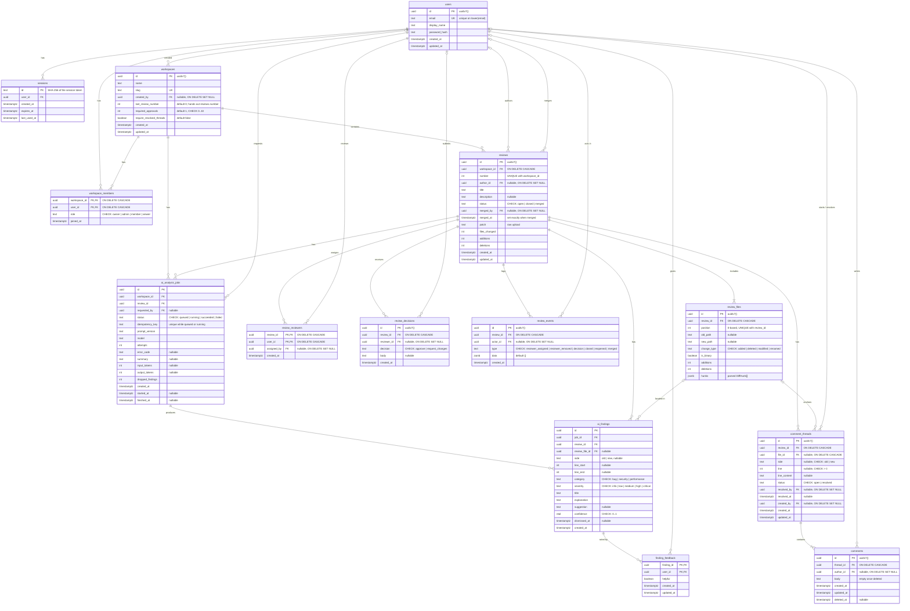

# Database

The database design: implemented and proposed tables, constraints, indexes, transactions, concurrency and pagination.

[← Back to README](../README.md)

---

## Database Design

> [!NOTE]
> **Implemented:** the `users`, `sessions`, `workspaces`, `workspace_members`, `reviews`, `review_files`, `comment_threads`, `comments`, `review_reviewers`, `review_decisions` and `review_events` tables (Drizzle schema in `apps/api/src/db/schema`, migrations in `apps/api/drizzle`). The workspace tables are served by `/api/v1/workspaces` (see [api.md](api.md#workspaces-and-membership)). The review tables are served by the review routes (see [api.md](api.md#reviews)). The comment tables are served by the thread routes (see [api.md](api.md#comment-threads)). The approval tables have a data layer (`apps/api/src/modules/approvals/service.ts`) but no routes yet. Every other table below is a **proposal**. It will change during implementation and will not be considered final until it exists as Drizzle schema and migrations.

### Entity-relationship diagram (all implemented)

### Table responsibilities

| Table               | Responsibility                                                                                                                                                                                                                                                                                                                                                                                                                                                                                |
| ------------------- | --------------------------------------------------------------------------------------------------------------------------------------------------------------------------------------------------------------------------------------------------------------------------------------------------------------------------------------------------------------------------------------------------------------------------------------------------------------------------------------------- |
| `users`             | Identity and credentials (password hash only; never plaintext). **Implemented.**                                                                                                                                                                                                                                                                                                                                                                                                              |
| `sessions`          | Server-side sessions. Stores only a SHA-256 hash of each token, with a 7-day absolute expiry. Cascades on user delete. **Implemented.**                                                                                                                                                                                                                                                                                                                                                       |
| `workspaces`        | Top-level tenancy boundary. Every review will belong to exactly one workspace. `slug` is derived from the name (lowercase letters, digits and hyphens, at most 40 characters, with a random 4-character suffix on collision). `created_by` becomes `NULL` if the creator's account is deleted, so the workspace survives. **Implemented.**                                                                                                                                                    |
| `workspace_members` | Join table between users and workspaces carrying the member's **role** (`owner`, `admin`, `member` or `viewer`, enforced by a `CHECK` constraint). The basis for authorization. Rows are deleted with their workspace or their user. **Implemented.**                                                                                                                                                                                                                                         |
| `reviews`           | A unit of review: an uploaded patch with title, description, author and status (`open` or `closed`). Numbered 1, 2, 3 … per workspace from `workspaces.last_review_number`. Keeps the raw patch and file/addition/deletion totals. The author becomes `NULL` if their account is deleted. **Implemented**; revisions and an optimistic-lock `version` are planned.                                                                                                                            |
| `review_files`      | One row per file of a review, in patch order (`position`): paths, change type, binary flag, line counts and the parsed hunks as `jsonb` (always read whole, never queried into). **Implemented**; a `revision` column is planned.                                                                                                                                                                                                                                                             |
| `comment_threads`   | A discussion on a review: about the review as a whole, or anchored to one line on one side (`old` / `new`) of one file. The anchor is `file_id`, `side`, `line` and `line_content` (the line's text when the thread started), all set or all `NULL` (`comment_threads_anchor_check`). `status` is `open` or `resolved`; `resolved_at` is set exactly when resolved (`comment_threads_resolved_check`). The creator and resolver become `NULL` if their accounts are deleted. **Implemented.** |
| `comments`          | The comments of a thread, oldest first. Deleting one is a **soft delete**: `deleted_at` is set and `body` emptied, but the row stays so the thread keeps its shape. The author becomes `NULL` if their account is deleted. **Implemented.**                                                                                                                                                                                                                                                   |
| `review_reviewers`  | Who is asked to review a review. One row per (review, user); `assigned_by` becomes `NULL` if the assigner's account is deleted. Removing a reviewer deletes the row, so their decisions stop counting. **Implemented.**                                                                                                                                                                                                                                                                       |
| `review_decisions`  | **Append-only** reviewer decisions (`approve` / `request_changes`, optional `body`). A changed mind is a new row; a reviewer's latest row is the one that counts. `reviewer_id` becomes `NULL` if their account is deleted, keeping the history. **Implemented.**                                                                                                                                                                                                                             |
| `review_events`     | The review's history: reviewer assigned/removed, decisions, closed, reopened, merged, with the actor and a small `jsonb` payload (e.g. `{ "userId": … }`). Written in the same transaction as the change it records. **Implemented.**                                                                                                                                                                                                                                                         |
| `ai_analysis_jobs`  | Lifecycle and audit record for each analysis request: status, attempts, error code, model and prompt version.                                                                                                                                                                                                                                                                                                                                                                                 |
| `ai_findings`       | Structured findings from a job, linked to the review and — when applicable — a specific file, side and line range.                                                                                                                                                                                                                                                                                                                                                                            |
| `finding_feedback`  | One helpful / not-helpful answer per (finding, user); answering again updates the row. Deleted with its finding or its user (cascade). Index on `user_id` for the user cascade. **Implemented** (migration `0008_finding_feedback`).                                                                                                                                                                                                                                                          |

`workspaces.required_approvals` and `workspaces.require_resolved_threads` hold the workspace's merge rules. `reviews.status` gained `merged` (final), with `merged_by` / `merged_at`. In-app notifications use `notifications` and `outbox_events` (migration `0006_notifications`); see [architecture.md](architecture.md#notifications-and-the-transactional-outbox).

### Foreign keys and referential integrity

- All relationships are enforced with foreign keys; application code does not rely on "soft" references.
- **Implemented:** `ON DELETE CASCADE` from `users` to `sessions`, and from `workspaces` and `users` to `workspace_members`. `ON DELETE SET NULL` from `users` to `workspaces.created_by`, so deleting an account never deletes a shared workspace.
- **Implemented:** `ON DELETE CASCADE` from `workspaces` to `reviews` and from `reviews` to `review_files`. `ON DELETE SET NULL` from `users` to `reviews.author_id`, so a review survives its author's account.
- **Implemented:** `ON DELETE CASCADE` from `reviews` and `review_files` to `comment_threads`, and from `comment_threads` to `comments`. `ON DELETE SET NULL` from `users` to `comment_threads.created_by`, `comment_threads.resolved_by` and `comments.author_id`, so a discussion survives the accounts of the people in it.
- **Implemented:** comments are soft-deleted (`deleted_at`, empty `body`), so a thread keeps its replies in place.
- **Implemented:** `ON DELETE CASCADE` from `reviews` to `review_reviewers`, `review_decisions` and `review_events`, and from `users` to `review_reviewers.user_id`. `ON DELETE SET NULL` from `users` to `reviews.merged_by`, `review_reviewers.assigned_by`, `review_decisions.reviewer_id` and `review_events.actor_id`, so the history survives the accounts of the people in it.
- `ON DELETE CASCADE` from `reviews` to `ai_analysis_jobs` and `ai_findings`, so deleting a review cannot leave orphans.
- **Implemented:** `CHECK` constraints `workspace_members_role_check` (the four roles), `reviews_status_check` (`open`, `closed`, `merged`), `reviews_merged_check` (`(status = 'merged') = (merged_at is not null)`; `merged_by` is left out because it becomes `NULL` when the account is deleted), `workspaces_required_approvals_check` (`0..10`), `review_decisions_decision_check`, `review_events_type_check`, `review_files_change_type_check`, and on `comment_threads`: the side and status lists, `line > 0`, the all-or-nothing anchor (`num_nulls(file_id, side, line, line_content) in (0, 4)`) and `(status = 'resolved') = (resolved_at is not null)`. Each list comes from a shared `as const` array.
- A thread's file must belong to the thread's review. The service checks this (and that the line exists on that side of the file's hunks) before inserting; a composite foreign key on `(file_id, review_id)` could enforce it in the database too.

### Unique constraints

| Constraint                                               | Purpose                                                                                              |
| -------------------------------------------------------- | ---------------------------------------------------------------------------------------------------- |
| `users(lower(email))`                                    | One account per email address, case-insensitive. **Implemented.**                                    |
| `workspaces(slug)`                                       | Stable, unique URLs. **Implemented** (`workspaces_slug_unique`).                                     |
| `workspace_members(workspace_id, user_id)` (primary key) | A user has exactly one role per workspace. **Implemented.**                                          |
| `reviews(workspace_id, number)`                          | One review per number in a workspace. **Implemented** (`reviews_workspace_id_number_unique`).        |
| `review_files(review_id, position)`                      | One file per position in a review. **Implemented** (`review_files_review_id_position_unique`).       |
| `review_reviewers(review_id, user_id)` (primary key)     | A user is assigned to a review at most once. **Implemented** (inserts use `ON CONFLICT DO NOTHING`). |
| `ai_analysis_jobs(idempotency_key)`                      | Prevents duplicate jobs for the same review revision, analysis type and prompt version.              |

### Indexes for common access patterns

| Access pattern                                                      | Index                                                                                                                                           |
| ------------------------------------------------------------------- | ----------------------------------------------------------------------------------------------------------------------------------------------- |
| List reviews in a workspace, newest first                           | `reviews(workspace_id, created_at DESC, id DESC)` (`reviews_workspace_id_created_at_id_idx`), for a `(created_at, id)` cursor. **Implemented.** |
| Reviews by author (and the `author_id` foreign key)                 | `reviews(author_id)` (`reviews_author_id_idx`). **Implemented.**                                                                                |
| Files of a review in order                                          | The `review_files(review_id, position)` unique index. **Implemented.**                                                                          |
| Threads of a review (and the `review_id` foreign key)               | `comment_threads(review_id, file_id)` (`comment_threads_review_id_file_id_idx`). **Implemented.**                                               |
| The `file_id` foreign key (cascade from `review_files`)             | `comment_threads(file_id)` (`comment_threads_file_id_idx`). **Implemented.**                                                                    |
| Comments of threads, oldest first (and the `thread_id` foreign key) | `comments(thread_id, created_at)` (`comments_thread_id_created_at_idx`). **Implemented.**                                                       |
| `SET NULL` when a user is deleted                                   | `comment_threads(created_by)`, `comment_threads(resolved_by)`, `comments(author_id)`. **Implemented.**                                          |
| Latest decision per reviewer (and the `review_id` foreign key)      | `review_decisions(review_id, reviewer_id, created_at DESC)`, read with `DISTINCT ON (reviewer)`. **Implemented.**                               |
| Reviews waiting for me                                              | `review_reviewers(user_id)` (`review_reviewers_user_id_idx`). **Implemented.**                                                                  |
| A review's history, oldest first                                    | `review_events(review_id, created_at)`. **Implemented.**                                                                                        |
| `SET NULL` when a user is deleted (approvals)                       | `reviews(merged_by)`, `review_reviewers(assigned_by)`, `review_decisions(reviewer_id)`, `review_events(actor_id)`. **Implemented.**             |
| Active analysis jobs                                                | Partial index `ai_analysis_jobs(review_id) WHERE status IN ('queued','running')`                                                                |
| Findings for a file                                                 | `ai_findings(review_file_id, line_start)`                                                                                                       |
| Workspaces for a user                                               | `workspace_members(user_id)` (`workspace_members_user_id_idx`). **Implemented.**                                                                |

### Transactions

Operations that change more than one row run in a single transaction, for example:

- **Starting a thread (Implemented):** insert the `comment_threads` row and its first `comments` row together, so a thread never exists without a comment. The anchor is checked before the transaction opens.
- **Creating a workspace (Implemented):** insert the `workspaces` row and the creator's `owner` membership together, so a workspace never exists without an owner. On a slug collision the whole transaction is retried with a suffixed slug (a failed statement aborts a Postgres transaction, so it can't be retried inside it).
- **Creating a review (Implemented):** the patch is parsed first, outside the transaction. Then `UPDATE workspaces SET last_review_number = last_review_number + 1 … RETURNING` takes the next number (the row lock serialises concurrent creates), and the review and all its files are inserted (the files in one multi-row `INSERT`). A failure rolls everything back, including the number.
- **Submitting a decision (Implemented):** lock the review row (`SELECT … FOR UPDATE`), check it is open and the user is an assigned reviewer, then insert the `review_decisions` row and its `decision` event.
- **Assigning or removing reviewers, closing, reopening (Implemented):** the change and its `review_events` row(s) in one transaction, under the review's row lock. Status changes go through the shared `canTransition`.
- **Merging (Implemented):** lock the review row, then re-read the rules, latest decisions and open-thread count inside the transaction, evaluate them, and only then set `status = 'merged'`, `merged_by`, `merged_at` and write the `merged` event.
- **Submitting a new revision:** insert new `review_files`, increment `current_revision`, mark comments on changed lines `is_outdated`, set status back to `in_review`.
- **Completing an analysis:** insert all `ai_findings` and set the job to `succeeded` atomically, so clients never see a "succeeded" job with partial findings.

### Concurrency

- **Optimistic locking** on `reviews.version`: state-changing requests include the version they read, and the update uses `WHERE id = $1 AND version = $2`. A zero-row update returns `409 Conflict`, and the client re-fetches.
- **Row locks (Implemented):** every approval write (decision, assignment, close/reopen, delete, merge) starts with `SELECT … FOR UPDATE` on the review row. A merge and a racing request for changes are serialised: whichever locks second sees the other's committed result (the merge is refused, or the decision finds a merged review). Under `READ COMMITTED` each statement after the lock reads fresh data, which is why the merge re-reads everything _after_ locking.
- Thread resolution is idempotent: resolving an already-resolved thread is a no-op.

### Pagination

List endpoints use **keyset (cursor) pagination** on `(created_at, id)` or `(updated_at, id)` rather than `OFFSET`, which keeps page cost stable on large tables and avoids skipped or duplicated rows when new comments arrive while paging. Cursors are opaque, encoded tokens; page size is bounded server-side.
