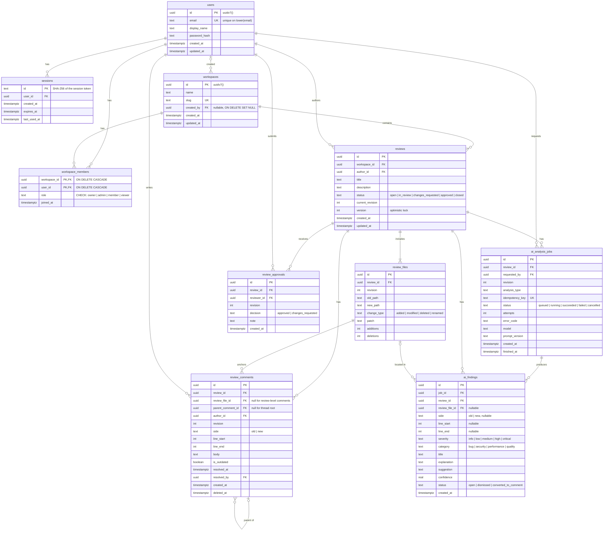

# Database

The database design: implemented and proposed tables, constraints, indexes, transactions, concurrency and pagination.

[← Back to README](../README.md)

---

## Database Design

> [!NOTE]
> **Implemented:** the `users`, `sessions`, `workspaces` and `workspace_members` tables (Drizzle schema in `apps/api/src/db/schema`, migrations in `apps/api/drizzle`). The workspace tables are served by `/api/v1/workspaces` (see [api.md](api.md#workspaces-and-membership)). Every other table below is a **proposal**. It will change during implementation and will not be considered final until it exists as Drizzle schema and migrations.

### Entity-relationship diagram (`users`, `sessions`, `workspaces` and `workspace_members` implemented; the rest proposed)

### Table responsibilities

| Table               | Responsibility                                                                                                                                                                                                                                                                                                                             |
| ------------------- | ------------------------------------------------------------------------------------------------------------------------------------------------------------------------------------------------------------------------------------------------------------------------------------------------------------------------------------------ |
| `users`             | Identity and credentials (password hash only; never plaintext). **Implemented.**                                                                                                                                                                                                                                                           |
| `sessions`          | Server-side sessions. Stores only a SHA-256 hash of each token, with a 7-day absolute expiry. Cascades on user delete. **Implemented.**                                                                                                                                                                                                    |
| `workspaces`        | Top-level tenancy boundary. Every review will belong to exactly one workspace. `slug` is derived from the name (lowercase letters, digits and hyphens, at most 40 characters, with a random 4-character suffix on collision). `created_by` becomes `NULL` if the creator's account is deleted, so the workspace survives. **Implemented.** |
| `workspace_members` | Join table between users and workspaces carrying the member's **role** (`owner`, `admin`, `member` or `viewer`, enforced by a `CHECK` constraint). The basis for authorization. Rows are deleted with their workspace or their user. **Implemented.**                                                                                      |
| `reviews`           | A unit of review: title, author, status, current revision and an optimistic-lock `version`.                                                                                                                                                                                                                                                |
| `review_files`      | Per-file changes for a given revision, including paths, change type, the unified patch and line counts.                                                                                                                                                                                                                                    |
| `review_comments`   | Line-anchored or review-level comments. `parent_comment_id` (self-reference) forms threads; resolution is stored on the thread root.                                                                                                                                                                                                       |
| `review_approvals`  | Reviewer decisions per revision (`approved` / `changes_requested`). A new revision invalidates earlier decisions by default.                                                                                                                                                                                                               |
| `ai_analysis_jobs`  | Lifecycle and audit record for each analysis request: status, attempts, error code, model and prompt version.                                                                                                                                                                                                                              |
| `ai_findings`       | Structured findings from a job, linked to the review and — when applicable — a specific file, side and line range.                                                                                                                                                                                                                         |

Reviewer assignment and notifications will likely require additional tables (`review_reviewers`, `notifications`), which are included in the roadmap.

### Foreign keys and referential integrity

- All relationships are enforced with foreign keys; application code does not rely on "soft" references.
- **Implemented:** `ON DELETE CASCADE` from `users` to `sessions`, and from `workspaces` and `users` to `workspace_members`. `ON DELETE SET NULL` from `users` to `workspaces.created_by`, so deleting an account never deletes a shared workspace.
- `ON DELETE CASCADE` from `reviews` to `review_files`, `review_comments`, `review_approvals`, `ai_analysis_jobs` and `ai_findings`, so deleting a review cannot leave orphans.
- `ON DELETE RESTRICT` (or soft-delete) for `users` referenced as authors, so history is not silently lost.
- Comments use soft deletion (`deleted_at`) so that replies in a thread remain coherent.
- **Implemented:** `CHECK` constraint `workspace_members_role_check` allows only the four roles.
- `CHECK` constraints: `line_end >= line_start`; line fields are either all null or all set; `parent_comment_id <> id`.
- Replies must belong to the same review as their parent; enforced in the service layer (and optionally by a composite foreign key on `(review_id, parent_comment_id)`).

### Unique constraints

| Constraint                                               | Purpose                                                                                 |
| -------------------------------------------------------- | --------------------------------------------------------------------------------------- |
| `users(lower(email))`                                    | One account per email address, case-insensitive. **Implemented.**                       |
| `workspaces(slug)`                                       | Stable, unique URLs. **Implemented** (`workspaces_slug_unique`).                        |
| `workspace_members(workspace_id, user_id)` (primary key) | A user has exactly one role per workspace. **Implemented.**                             |
| `review_files(review_id, revision, new_path)`            | No duplicate file entries within a revision.                                            |
| `review_approvals(review_id, reviewer_id, revision)`     | One decision per reviewer per revision (updates replace it).                            |
| `ai_analysis_jobs(idempotency_key)`                      | Prevents duplicate jobs for the same review revision, analysis type and prompt version. |

### Indexes for common access patterns

| Access pattern                                      | Index                                                                                                                     |
| --------------------------------------------------- | ------------------------------------------------------------------------------------------------------------------------- |
| List reviews in a workspace by status, newest first | `reviews(workspace_id, status, updated_at DESC, id)`                                                                      |
| "My reviews"                                        | `reviews(author_id, updated_at DESC)`                                                                                     |
| Load all comments for a review                      | `review_comments(review_id, created_at, id)`                                                                              |
| Load comments for a file in the diff viewer         | `review_comments(review_file_id, line_start)`                                                                             |
| Load replies for a thread                           | `review_comments(parent_comment_id)`                                                                                      |
| Count unresolved threads                            | Partial index `review_comments(review_id) WHERE parent_comment_id IS NULL AND resolved_at IS NULL AND deleted_at IS NULL` |
| Latest decisions                                    | `review_approvals(review_id, revision)`                                                                                   |
| Active analysis jobs                                | Partial index `ai_analysis_jobs(review_id) WHERE status IN ('queued','running')`                                          |
| Findings for a file                                 | `ai_findings(review_file_id, line_start)`                                                                                 |
| Workspaces for a user                               | `workspace_members(user_id)` (`workspace_members_user_id_idx`). **Implemented.**                                          |

### Transactions

Operations that change more than one row run in a single transaction, for example:

- **Creating a workspace (Implemented):** insert the `workspaces` row and the creator's `owner` membership together, so a workspace never exists without an owner. On a slug collision the whole transaction is retried with a suffixed slug (a failed statement aborts a Postgres transaction, so it can't be retried inside it).
- **Submitting a decision:** insert/update `review_approvals`, recompute and update `reviews.status`, bump `reviews.version`.
- **Submitting a new revision:** insert new `review_files`, increment `current_revision`, mark comments on changed lines `is_outdated`, set status back to `in_review`.
- **Completing an analysis:** insert all `ai_findings` and set the job to `succeeded` atomically, so clients never see a "succeeded" job with partial findings.

### Concurrency

- **Optimistic locking** on `reviews.version`: state-changing requests include the version they read, and the update uses `WHERE id = $1 AND version = $2`. A zero-row update returns `409 Conflict`, and the client re-fetches.
- **Row locks** (`SELECT … FOR UPDATE` on the review row) for status recomputation, so two simultaneous decisions cannot produce an inconsistent status.
- Thread resolution is idempotent: resolving an already-resolved thread is a no-op.

### Pagination

List endpoints use **keyset (cursor) pagination** on `(created_at, id)` or `(updated_at, id)` rather than `OFFSET`, which keeps page cost stable on large tables and avoids skipped or duplicated rows when new comments arrive while paging. Cursors are opaque, encoded tokens; page size is bounded server-side.
