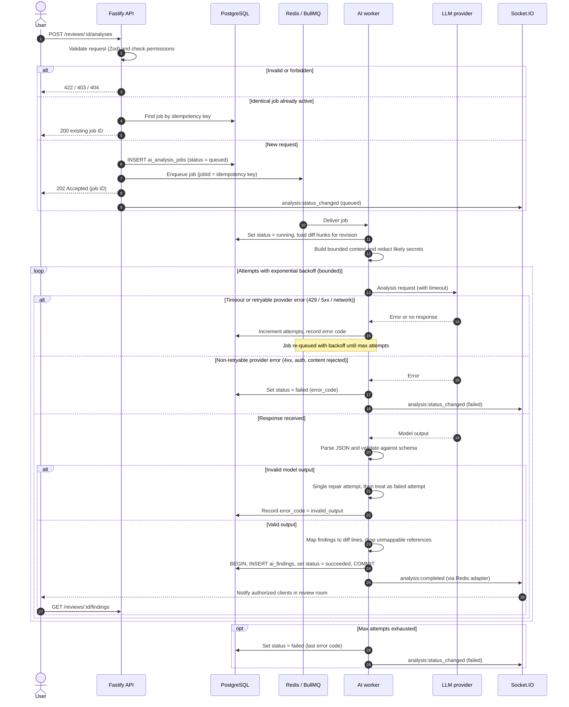

# AI Analysis (Planned)

The planned AI analysis pipeline and its background jobs and failure handling. **Planned (Stage 8): none of this is implemented yet.**

[← Back to README](../../README.md)

---

## AI Analysis Pipeline

> Status: **Planned**. The provider is intentionally abstracted; no specific provider or model is committed to yet.

### Pipeline stages

1. **Request.** The API validates the request (analysis type, revision, optional file subset) and the caller's permission.
2. **De-duplication.** An idempotency key `hash(review_id, revision, analysis_type, file_set, prompt_version)` is computed. If a `queued`/`running` or recent `succeeded` job exists with that key, it is returned instead of creating a new one.
3. **Job creation.** A row is inserted into `ai_analysis_jobs` and a BullMQ job is enqueued with `jobId = idempotency_key`.
4. **Context assembly (worker).** The worker loads diff hunks for the revision, includes limited surrounding context, and enforces a size budget. Large reviews are split into per-file or per-chunk calls.
5. **Redaction.** Likely secrets (API key patterns, private keys, `.env`-style assignments) are masked before anything leaves the system.
6. **Model call.** The provider is called server-side with a timeout, using a prompt that requests JSON conforming to a schema. Submitted code is framed as **untrusted data**, not instructions.
7. **Output validation.** The response is parsed and validated with a Zod schema. Each finding's file and line range must map to lines present in the analyzed diff; findings that do not are dropped or attached at review level and flagged.
8. **Persistence.** Findings and the job's final status are written in one transaction.
9. **Notification.** An `analysis:completed` event is published to the review room; clients fetch findings over HTTP.

### Finding schema (proposed)

```ts
// packages/shared/src/ai/finding.ts  (proposed — not yet implemented)
import { z } from 'zod';

export const AiFinding = z.object({
  category: z.enum(['bug', 'security', 'performance', 'quality']),
  severity: z.enum(['info', 'low', 'medium', 'high', 'critical']),
  title: z.string().min(1).max(200),
  explanation: z.string().min(1).max(4000),
  suggestion: z.string().max(4000).optional(),
  file: z.string().optional(), // path as it appears in the diff
  side: z.enum(['old', 'new']).optional(),
  lineStart: z.number().int().positive().optional(),
  lineEnd: z.number().int().positive().optional(),
  confidence: z.number().min(0).max(1),
});

export const AiAnalysisResult = z.object({
  summary: z.string().max(4000),
  findings: z.array(AiFinding).max(100),
});
```

### Analysis sequence (proposed)



### Presentation in the UI

- Findings are visually distinct from human comments and labeled as AI-generated.
- Each finding shows severity, category, explanation and confidence, and links to its lines.
- Reviewers can **dismiss** a finding or **convert it into a thread**, at which point it is discussed and resolved like any other comment.
- Findings never change review status.

---

## Background Jobs and Failure Handling

> Status: **Planned**.

| Concern                          | Approach                                                                                                                                             |
| -------------------------------- | ---------------------------------------------------------------------------------------------------------------------------------------------------- |
| **Job states**                   | `queued → running → succeeded \| failed`, plus `cancelled`. The DB row is the user-visible status; BullMQ state is the execution mechanism.          |
| **Timeouts**                     | Each LLM call has a hard client-side timeout; each job has an overall time budget.                                                                   |
| **Retries**                      | Bounded attempts with exponential backoff and jitter for transient errors (timeouts, `429`, `5xx`, network errors).                                  |
| **Non-retryable errors**         | Authentication/configuration errors, request too large, content rejected, and repeated invalid output fail immediately with an `error_code`.         |
| **Duplicate prevention**         | Unique `idempotency_key` in the database plus BullMQ `jobId` de-duplication.                                                                         |
| **Idempotent completion**        | Findings for a job are written in the same transaction that marks it `succeeded`; a retried job first deletes any partial findings for that job ID.  |
| **Stalled jobs**                 | BullMQ stalled-job detection re-queues jobs whose worker died; the worker's status update is conditional on the current status to avoid regressions. |
| **Concurrency and cost control** | Worker concurrency limit, a per-workspace rate limit on analysis requests and a maximum diff size per analysis.                                      |
| **Observability**                | Structured logs with job ID, review ID, attempt, duration and error code — never including source code or prompts. Failed jobs remain inspectable.   |
| **Graceful shutdown**            | The worker stops accepting jobs and finishes or releases in-flight jobs on `SIGTERM`.                                                                |
