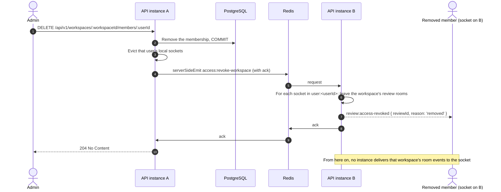
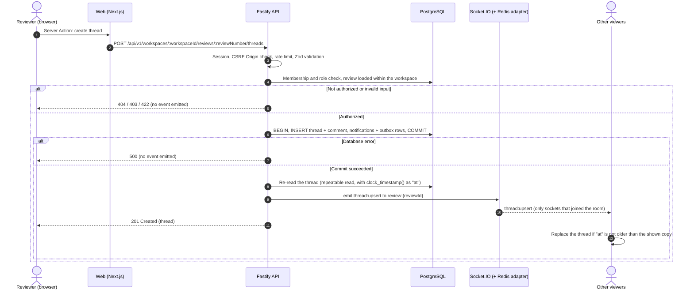

# Real-Time Events

The Socket.IO design as built: rooms, events, design rules and the comment broadcast sequence. **Implemented (Stage 7).** The implementation walkthrough (tickets, web client, presence, shutdown) is in [architecture.md](../architecture.md#real-time). Payloads and the routes that emit them are listed in [api.md](../api.md#real-time).

[← Back to README](../../README.md)

---

## Real-Time Event Architecture

> Status: **Implemented**.

### Connecting

The web app (Vercel) and the API (Render) are on different domains, and a Next.js rewrite can't carry a WebSocket upgrade. The browser therefore connects **straight to the API** (`NEXT_PUBLIC_REALTIME_URL`, path `/socket.io`, WebSocket transport only, `Origin` must be `WEB_ORIGIN`). It authenticates with a single-use ticket from `POST /api/v1/realtime/ticket`, fetched through the rewrite with the session cookie. The ticket is stored hashed in Redis for 30 seconds with the user and session it was issued for, and consumed with `GETDEL`, so it can be used only once; the handshake also requires that session to still be valid.

### Rooms

| Room                | Members                                                                                          | Events                                                                                                                                                      |
| ------------------- | ------------------------------------------------------------------------------------------------ | ----------------------------------------------------------------------------------------------------------------------------------------------------------- |
| `user:{userId}`     | Every socket of that user, joined automatically on connect                                       | `notification:new`                                                                                                                                          |
| `review:{reviewId}` | Sockets that sent `review:join` and passed the membership check, until they leave or lose access | `thread:upsert`, `review:changed`, `review:deleted`, `analysis:status`, `analysis:completed`, `presence`; `review:access-revoked` to an evicted socket only |

There is no workspace room: the review list and workspace pages are not live.

### Events

| Event                   | Direction       | Payload (summary)                                                                    |
| ----------------------- | --------------- | ------------------------------------------------------------------------------------ |
| `review:join`           | Client → Server | `{ workspaceId, reviewNumber }`; acknowledged with `{ ok, reviewId }` or an error    |
| `review:leave`          | Client → Server | `{ reviewId }`                                                                       |
| `thread:upsert`         | Server → Client | The full thread with its comments                                                    |
| `review:changed`        | Server → Client | `reason`: `reviewers`, `decision`, `status`, `merged` or `updated`                   |
| `review:deleted`        | Server → Client | Review ID only                                                                       |
| `analysis:status`       | Server → Client | The full AI job (status `queued`, `running`, `succeeded`, `failed`)                  |
| `analysis:completed`    | Server → Client | Job ID and the number of stored findings                                             |
| `presence`              | Server → Client | Distinct users viewing the review (capped at 50) and the total                       |
| `review:access-revoked` | Server → Client | `{ reviewId, reason: 'removed' \| 'workspace_deleted' }`, to the evicted socket only |
| `notification:new`      | Server → Client | The notification (to `user:{userId}` only)                                           |

Domain events carry `reviewId`, `actorId` and `at` (read from the database clock). Every payload has a Zod schema in `packages/shared/src/realtime.ts`, and the web client validates each event and drops invalid ones.

### Design rules

- **Writes go through HTTP, not sockets.** Mutations use REST endpoints, so they share validation, authorization, rate limiting and error handling. Sockets carry events only (plus join and leave).
- **Emit after commit.** Room events are emitted only after the service's transaction has committed. A failed or rolled-back request emits nothing.
- **Events are hints.** Room events are delivered at most once. Clients keep the copy with the newest `at`, and after reconnecting they re-join and re-fetch over HTTP.
- **Notifications are at least once.** They go through a [transactional outbox](../architecture.md#notifications-and-the-transactional-outbox) instead of a direct emit, so a crash between commit and emit can't lose them. Clients dedupe by notification ID.
- **Presence is derived, not stored.** The viewer list is computed from the sockets in the room (`fetchSockets()`, across instances through the adapter), coalesced to one emit per 500 ms. Nothing has to expire.
- **Multi-instance ready.** The Socket.IO Redis adapter lets any API instance, including the in-process AI worker and the outbox relay, broadcast to a room.
- **Access ends when membership or the session ends.** Removing a member, leaving and deleting a workspace evict the affected sockets from that workspace's review rooms on every instance, acknowledged before the HTTP response; logout disconnects that session's sockets; a 5-minute safety net re-checks every socket. Details: [Access lifecycle](#access-lifecycle).
- **Known gap:** approval rule changes (`PATCH …/rules`) aren't broadcast yet. Open review pages see them after a refresh.

### Access lifecycle

| Trigger                                                               | Who               | Effect on sockets                                                                           |
| --------------------------------------------------------------------- | ----------------- | ------------------------------------------------------------------------------------------- |
| `DELETE …/members/:userId`, `POST …/members/leave`                    | That user         | Leaves every review room of the workspace; `review:access-revoked` with `reason: 'removed'` |
| `DELETE /api/v1/workspaces/:workspaceId`                              | Every member      | Same, with `reason: 'workspace_deleted'`                                                    |
| Role change (`PATCH …/members/:userId`)                               | —                 | Nothing: every role may view                                                                |
| Logout, login replacing a session, expired session found on a request | That session only | `disconnect(true)`; the reconnect's ticket request gets `401`                               |
| Safety net, every 5 minutes, per instance                             | Its own sockets   | One query for all memberships and sessions; evicts or disconnects as above                  |

On the web, `review:access-revoked` stops the page's subscription for that review: later events are ignored, presence is cleared, reconnects don't re-join, and a banner says "You no longer have access to this review" with a link to the workspaces. When the ticket request answers `401` (the session ended), the client stops reconnecting and the page says "Your session ended" with a link to log in.

### Comment broadcast sequence

The notification for the review author is delivered separately by the outbox relay, within about a second, as `notification:new` to `user:{authorId}`.
