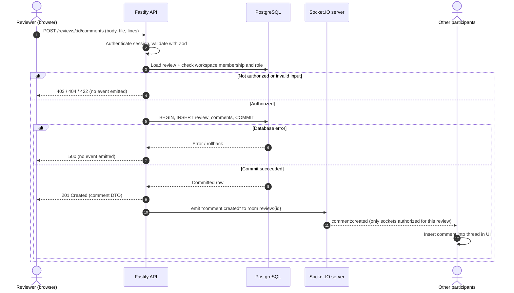

# Real-Time Events (Planned)

The planned Socket.IO design: rooms, events, design rules and the comment broadcast sequence. **Planned (Stage 7): none of this is implemented yet.**

[← Back to README](../../README.md)

---

## Real-Time Event Architecture

> Status: **Planned**.

### Rooms

| Room                      | Members                                  | Typical events                                              |
| ------------------------- | ---------------------------------------- | ----------------------------------------------------------- |
| `user:{userId}`           | All of a user's connections              | Notifications, assignment events                            |
| `workspace:{workspaceId}` | Authorized members viewing the workspace | Review created, review status changed                       |
| `review:{reviewId}`       | Authorized members viewing the review    | Comments, resolutions, approvals, presence, analysis status |

### Events (proposed)

| Event                                                     | Direction       | Payload (summary)                  |
| --------------------------------------------------------- | --------------- | ---------------------------------- |
| `review:join` / `review:leave`                            | Client → Server | `reviewId` (authorized on join)    |
| `comment:created` / `comment:updated` / `comment:deleted` | Server → Client | Comment DTO                        |
| `thread:resolved` / `thread:reopened`                     | Server → Client | Thread ID, actor                   |
| `review:status_changed`                                   | Server → Client | Review ID, status, version         |
| `approval:submitted`                                      | Server → Client | Reviewer, decision, revision       |
| `analysis:status_changed`                                 | Server → Client | Job ID, status                     |
| `analysis:completed`                                      | Server → Client | Job ID, finding count by severity  |
| `presence:update`                                         | Server → Client | Users currently viewing the review |
| `notification:new`                                        | Server → Client | Notification DTO                   |

All payloads are defined as Zod schemas in `packages/shared` and validated on both sides.

### Design rules

- **Writes go through HTTP, not sockets.** Mutations use REST endpoints so they share validation, authorization, rate limiting and error handling. Sockets carry notifications only (plus join/leave and presence).
- **Emit after commit.** Events are emitted only after the database transaction succeeds. A failed write never produces a success event.
- **Events are hints.** Each event carries IDs and a `version` so clients can detect gaps; on reconnect clients re-fetch state over HTTP.
- **Presence is ephemeral.** Presence uses Redis keys with a short TTL refreshed by heartbeats, so disconnected users disappear without explicit cleanup.
- **Multi-instance ready.** The Socket.IO Redis adapter lets any API instance — or the worker, via an emitter — broadcast to a room.
- A transactional outbox (writing events to a table in the same transaction and publishing them afterwards) is a candidate improvement if at-least-once delivery becomes necessary.

### Comment broadcast sequence (proposed)

